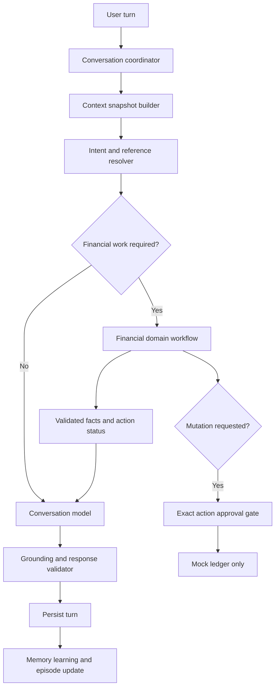

# Victoria: Conversational Core, Memory, and Personalization — Evidence-Backed Engineering Review

**Review date:** October 27, 2026  
**Repository:** [`NeverEverFelix/victoria`](https://github.com/NeverEverFelix/victoria)  
**Inspected ref:** `feature/conversational-memory-personalization`, commit `8b92be3f4d7a1310341786239e0ad1678a3ca86b`  
**Relevant PRs:** [#20: Expand conversational memory and personalization](https://github.com/NeverEverFelix/victoria/pull/20), stacked on [#19](https://github.com/NeverEverFelix/victoria/pull/19)  
**Method:** Read source code and repository PR metadata, including specific routing, response-validation, memory, and context-building implementations. No live end-to-end execution or local test rerun was performed. Some repository session-history notes explicitly say their most recent changes were *uncommitted and unpushed*; this report does **not** assume those local modifications are available on GitHub.

## Executive conclusion

Victoria has substantial infrastructure for a personalized companion: an agent orchestrator, SQLite-backed recent conversation context, Postgres/semantic durable memory, memory correction and forgetting, episodic summarization, a typed conversation context builder, pending financial workflow state, a separate OpenAI conversational responder, and guarded mocked-ledger tools. But it is still primarily a **financial workflow orchestrator with conditional conversational branches**, not a **conversation-first assistant with optional financial capabilities**.

The key next milestone should be **Conversational Core v1**: every user turn enters a coherent conversational pipeline; the model receives a single canonical, provenance-aware context snapshot; financial domain specialists supply advisory or authoritative information only when required; deterministic code exclusively controls financial side effects; replies adapt length to user intent; memory learning is scoped, evidence-based and reversible. The existing code should be incrementally refactored rather than discarded.

## 1. Intended product behavior

Victoria should act like an engaging, responsive, ChatGPT-style assistant **within its explicit financial-companion mission**. It should comfortably discuss interests, jobs, routines, goals and personal decisions; naturally relate relevant personal knowledge to budgeting and savings; maintain context through corrections and topic changes; and become genuinely more tailored over time. It should **not** continually redirect ordinary messages into savings proposals, equate projections with realized funds, imply real transfers, or fabricate personal facts.

### Product invariants

1. **Conversation is the default**. An intent router may identify additional work, but ordinary user messages always get a useful conversational answer unless an explicit safety/policy concern requires otherwise.
2. **Memory helps, never dictates.** Memories have evidence, source, confidence, scope, timestamp and correction/forget state. Contradictory or stale memories should not be stated as certainty.
3. **Financial state is authoritative data, not inferred prose.** A pending proposal, projection, saved ledger entry and a real transfer must have distinct types and semantics.
4. **No side effects from language generation.** Only explicit, version-specific, validated approvals can trigger the permitted mocked-ledger mutation. Real money movement remains disabled.
5. **The response answers the question first.** A workflow reminder or limitation should not displace a relevant answer.
6. **Depth is adaptive.** Short exchanges can receive short replies; complex requests can receive multi-paragraph, structured, calculated explanations with grounded facts.

## 2. Current system inventory and observed architecture

| Capability | Verified implementation evidence | Assessment |
|---|---|---|
| Request orchestration | `src/agent/victoria-agent.ts`, `VictoriaAgent.respond` and `respondTurn` | Centralized, complex, financial-first branching |
| Recent-turn memory | `getConversationContext`, `setConversationContext` in `VictoriaAgent.respond`, approx. lines 141–169 | Exists; limited bounded context used |
| Long-term memory | `MemoryOrchestrator`, `PostgresMemoryRepository`, `SqliteCachedMemoryProvider` | Substantial functionality, contextual use remains incomplete |
| Memory learning | `extractConversationalMemory`, optional model extractor, extraction path approx. lines 666–927 | Guarded but sometimes branch-gated |
| Episodic memory | `summarizeOverflowingConversation`, `summarizeConversation` approx. lines 173–200 | Present; extraction and recall limits matter |
| Context builder | `buildVictoriaConversationContext`, `selectMemoryFacts` | Typed workflow and financial context, not uniformly passed to response generation |
| Workflow state | `conversation-state-manager.ts` pending clarification and active proposal state | Good base; broader topic/dialogue state needed |
| General conversation | `OpenAiConversationResponder` and `respondConversationalTurn` | Optional route, subject to short-response constraints |
| Specialized responses | `classifyWithTeam`, specialist adapters and `team-response-policy.ts` | Necessary for finance; can dominate everyday conversation |
| Personalization | `OpenAiPersonalizedReply`, `selectPersonalizationMemories` | Exists but is an additional conditional rewrite path |
| Approval guard | `policy.ts`, pending action and mock ledger branches | Preserve exact-action approval boundaries |

### Current flow (simplified)

```text
request
  -> restore pending action(s)
  -> load prior conversation context
  -> save current user turn
  -> respondTurn()
      -> pending correction, allocation, savings branches
      -> rule-based and optional provider memory extraction
      -> ordinary-question shortcut sometimes invokes ConversationResponder
      -> otherwise classify with financial specialist team
      -> resolve financial references / proposals / validation
      -> decide financial workflow or general response
      -> optionally personalize some reflection replies
  -> save assistant turn
```

This is not inherently unsafe. Its downside is that **whether a user receives an open, natural reply depends on branch conditions**. An independent conversational layer does not have a stable first-class status.

## 3. Evidence-backed findings and failure examples

### Resolution status (October 27, 2026)

No finding has been fully closed against its complete review acceptance criteria. Nine findings have targeted implementation and regression coverage but still have broader requirements open; two remain architectural or release-readiness work without a completed fix. This is a progress count, not a claim that nine findings are resolved.

| Finding | Status | Remaining work |
|---|---|---|
| F1 Conversation routing | Partial | First-class intent routing and broader mixed-intent coverage. |
| F2 Typed context | Partial | Reuse a single per-turn snapshot across all applicable branches and finish representing identity, dialogue, and reference state explicitly. |
| F3 Response depth | Partial, near-complete | More evaluation of complex answers and style preferences; current deterministic modes are implemented. |
| F4 Derived amount validation | Partial | Extend typed grounding beyond canonical recurring-spend memories to other safely scoped durable financial facts. |
| F5 Fallback quality | Partial | Better grounded fallbacks and measured recovery quality beyond the current repair attempt and topic-specific cases. |
| F6 Pending workflow and dialogue | Partial | Separate dialogue state from immutable pending actions and exact-version approval routing. |
| F7 Memory learning | Partial | Durable post-turn extraction job boundary and reliability guarantees. |
| F8 Retrieval | Partial | Query rewriting, per-type budgets, conflict handling, and broader episodic retrieval. |
| F9 Episodic lifecycle | Partial | Database-gated lifecycle integration still needs execution; structured outcome summaries and retention work remain. |
| F10 Orchestrator size | Open | Incremental module extraction with compatibility coverage. |
| F11 Merge/configuration readiness | Open | Reconcile live PR/configuration state, migrations, CI, and review comments before merge. |

### F1 — Conversation route is conditional, not primary [HIGH; confirmed source]

**Evidence:** [`src/agent/victoria-agent.ts`](https://github.com/NeverEverFelix/victoria/blob/feature/conversational-memory-personalization/src/agent/victoria-agent.ts), approx. lines 929–933:

```ts
if (this.dependencies.conversationResponder && isOrdinaryQuestion(request.message) &&
    !hasFinancialActionSignal(request.message)) {
  return this.respondConversationalTurn(request, conversationContext,
    "I can help think that through. What would be most useful to focus on first?");
}
```

`isOrdinaryQuestion` around lines 2820–2824 requires `?` and excludes certain action phrases. `hasFinancialActionSignal` around lines 2844–2846 matches `\$`, “budget,” “bill,” “spending,” “money,” “savings,” and other terms. Those are coarse routing heuristics, not nuanced intent classification.

**Possible failure (architecture-derived scenario, NOT a verified live transcript):**

```text
User: I've been anxious about money ever since I got promoted.
Risk: No question mark; the ordinary-question shortcut does not trigger.
      The message enters a more financially oriented classification/workflow path.
Bad result class: Generic financial prompting rather than engaging the emotion or promotion context.
```

**Desired behavior:**

```text
Victoria: A promotion can improve your finances without making the decisions feel simpler.
What part has been weighing on you: expectations, spending changes, or something else?
```

**Change:** Introduce a first-class intent decision (`conversation`, `information`, `financial_analysis`, `financial_action`, `memory_management`) with multi-intent support. Default to conversation when action confidence is low. For financial discussion, answer conversationally while selectively invoking finance calculations. Avoid `?` as a prerequisite to conversational treatment.

**Implementation update (October 27, 2026):** A narrow regression test now covers the report's unpunctuated money reflection example. When the finance specialist classifies “I've been anxious about money ever since I got promoted” as `general_finance`, the existing read-only reflection path invokes the conversation responder, returns a reflective answer, and creates no proposal or ledger entry. The broader first-class intent router and mixed-intent handling remain open; this single case does not resolve the finding generally.

**Implementation update (October 27, 2026):** Explicit read-only topic switches phrased as “let's talk about … instead” can now pass a pending savings workflow even when the topic includes budget language. The pending proposal remains unchanged, no entry is created by the topic shift, and a later explicit yes still records the original suggestion. This closes one coarse routing false positive, not the broader intent-router finding.

**Implementation update (October 27, 2026):** A shared conversational-route predicate now recognizes explicit unpunctuated read-only topic statements, such as “I want to talk about changing jobs,” without requiring a question mark. It continues to leave finance-heavy statements to finance handling except for explicit read-only topic switches, and does not divert clear savings-recording language. Routing helper and agent regressions confirm the topic reaches the responder without a proposal or ledger entry. F1 remains partial; this rule does not replace the planned first-class, multi-intent router.

**Implementation update (October 27, 2026):** Added a mixed advice-and-record regression: “I skipped a $20 book. Can you talk through whether I should record it?” stays on the specialist savings path, creates only a pending suggestion, and does not call the read-only responder. A separate explicit “yes” is still required to create the mocked entry. This verifies one action-plus-question combination; broader multi-intent answering remains open.

**Implementation update (October 27, 2026):** Closed a second mixed-intent gap in a pending recurring-cost flow. When the user asks for annual math and asks to record this month in the same turn, the agent now explains the conditional annual projection, identifies the exact current-month pending amount, and requests explicit confirmation. A regression confirms that only a later “yes” records the monthly amount; the annual projection remains unrecorded. F1 remains partial for broader mixed-intent response composition.

**Implementation update (October 28, 2026):** A combined projection plus “record one this month” request now asks which single monthly cost is intended instead of answering only the math. It states the combined amount as conditional, never offers that combined total as recordable, and creates no entry; if a proposal is already pending, it remains pending and unchanged. F1 remains partial pending broader first-class intent routing and mixed-intent coverage.

**Implementation update (October 28, 2026):** A narrow read-only reflection route now recognizes unpunctuated emotional statements about budgets, bills, money, finances, or spending. “My budget feels overwhelming today” reaches the conversation responder even if a specialist labels it as avoided spending; a regression verifies no proposal or ledger entry is created. Explicit amounts and financial action verbs remain on the guarded finance route. This closes one acceptance example, while first-class multi-intent routing remains open.

**Implementation update (October 28, 2026):** The read-only route now also accepts unpunctuated non-financial topic statements such as “I feel hopeful about starting my new job,” without requiring the user to say “let's talk about.” Explicit purchase/action language such as ordering takeout stays on the financial route. Helper and agent regressions cover both sides. This advances the conversation-default behavior but remains a lightweight deterministic heuristic; F1's first-class multi-intent router is still open.

**Implementation update (October 28, 2026):** A specific emotional phrase, “I'm stressed about saving money,” now routes as read-only reflection while explicit amount/action language still stays guarded. A test-first regression reproduces its prior failure to reach conversation even when a specialist misclassified it as avoided spending; the responder now handles the concern without proposing a ledger entry. This expands the financial-emotion vocabulary narrowly; broader intent coverage and evaluation remain open.

**Implementation update (October 28, 2026):** A live mixed turn combining a $24 avoided takeout order and a Sunday cooking question received both a contextual answer and one exact mocked-ledger confirmation request. “That sounds good, I guess” did not record anything; an explicit yes later recorded one $24 entry, with no real money movement. Final response handling now normalizes “saved you $24” to “avoided spending $24” for validated avoided-spend suggestions, so the response does not frame the full amount as guaranteed money retained. Live testing initially exposed a repeat-amount clarification when Financial Moment had already extracted the amount but left `needsClarification` set; a narrow same-sentence purchase-and-amount grounding rule now resolves that mismatch only when the parsed amount exactly matches the specialist's amount. A fresh run of the alternate mixed wording answered both topics, asked once for confirmation, and left the entry pending after ambiguous assent. This remains targeted coverage; F1 is partial pending broader routing evaluation.

**Implementation update (October 28, 2026):** A live regretful-spend turn that repeated the same `$42` as a ledger reference was initially treated as multiple amounts, and its separate low-cost dinner question was missed. The amount parser now recognizes a later “the $42” reference as the same value while preserving clarification for different amounts and for identical amounts attached to separate purchases. Mixed-turn routing treats low-cost meal questions as ordinary conversational requests, and the regretful-spend response now appends a read-only dinner suggestion without creating a savings proposal. A fresh live run returned a nonjudgmental regret reflection plus a lentil-and-tomato soup idea; no ledger entry or suggestion was created. F1 remains partial because mixed intent handling and response quality need broader coverage.

**Implementation update (October 28, 2026):** A turn with an avoided-spend statement followed by a clearly separated non-financial question now receives both responses. The conversational responder handles only the extracted ordinary question; Victoria appends the exact savings confirmation request and preserves the pending proposal decision, so a later explicit approval records only that proposal. Sentence and comma-plus-question separators are covered, while financial action questions are excluded from extraction. The test confirms no entry exists before approval. F1 remains partial: this is a separator-bound mixed-turn rule, not the planned first-class intent router.

**Live-test correction (October 28, 2026):** A provider-backed run showed that the validated companion specialist already answered both parts of this mixed turn; invoking the separate conversational responder as well duplicated the ordinary answer. The orchestrator now uses the specialist response when it exists and invokes the separate responder only when specialist advice is absent. The same run exposed that confirmation validation could count an amount elsewhere in the paragraph as part of the approval question. Validation now requires the exact amount in the same question and replaces incomplete recording offers with one exact ledger confirmation. A second provider-backed run returned one dinner suggestion and one $18 approval question; an ambiguous follow-up remained pending. These fixes improve this case but do not close F1.

**Implementation update (October 29, 2026):** Financial reflections phrased as “I'm anxious about saving for retirement” now route to the read-only responder even when a specialist misclassifies them as avoided spending. The routing helper normalizes “saving for” only for reflection classification and still rejects explicit amount/action language, including “I'm anxious about saving $200 for retirement.” Helper and agent tests confirm no proposal or ledger entry is created. F1 remains partial; routing is still heuristic and broader multi-intent evaluation remains open.

**Implementation update (October 29, 2026):** The same guarded reflection route now handles “I'm worried I don't save enough for retirement.” It recognizes this narrow adequacy concern as reflection, while explicit amounts still take the financial path. Helper and agent regressions confirm no proposal or ledger entry is created. This expands coverage, not the first-class router; F1 remains partial.

**Implementation update (October 29, 2026):** A non-quantified reflection such as “I feel guilty about my spending lately” now routes to conversation instead of opening the regretful-spend workflow. Explicit amount/action wording remains on the financial path. Agent coverage forces the finance classifier to label the message as `regretful_spend` and verifies there is no proposal or ledger entry. This is another narrow read-only cue; F1 remains partial.

**Implementation update (October 29, 2026):** Mixed-turn extraction now checks all clearly separated clauses rather than assuming the financial statement comes first. “What could I cook for dinner? I avoided ordering takeout for $24” retains the read-only question and creates only one pending $24 confirmation; an explicit later approval remains required. Finance/action clauses are still excluded from conversational-question extraction. F1 remains partial because full multi-intent routing is still heuristic.

**Acceptance test:** Unpunctuated reflections, statements with money-related nouns, topic changes and indirect questions get substantive, context-specific conversational answers without any ledger proposal.

### F2 — General responder lacks the complete typed context [HIGH; confirmed source]

**Evidence:** [`conversation-responder.ts`](https://github.com/NeverEverFelix/victoria/blob/feature/conversational-memory-personalization/src/agent/conversation-responder.ts) defines input as `message`, `recentTurns`, `memories`, `baselineReply`, optional `pendingAction` and optional `conversationSavingsEvents`. `VictoriaAgent.respondConversationalTurn` around lines 1332–1354 creates this input from raw context strings and a simplified memory projection.

Yet [`conversation-context-builder.ts`](https://github.com/NeverEverFelix/victoria/blob/feature/conversational-memory-personalization/src/agent/conversation-context-builder.ts) can produce a richer `VictoriaConversationContext` with `financialFacts`, `selectedMemoryFacts`, `conversationSavingsEvents` and `workflowState` (approx. lines 121–172). This richer representation is used in finance-related classification, but it is not uniformly passed to the general responder.

**Possible failure:** A user references “the other amount” while the canonical pending proposal knows the monthly recordable amount and separate annual projection. A responder only looking at trimmed dialogue strings may be unable to distinguish whether “other” refers to a projection, a plan, or a ledger entry.

**Desired behavior:**

```text
User: Let's use the yearly number for the plan.
Victoria: We can plan around $420 for the year if the gym benefit continues.
That doesn't mean $420 has already been saved. We can track the plan separately
from any actual monthly savings you choose to record.
```

**Change:** Build one `ConversationContextSnapshot` per turn, containing messages, active topic, references, validated financial facts, memory provenance, episode retrieval and pending workflow state. Pass only the relevant safe view of this same snapshot to all generation and domain components. Crucially, ensure the model never gets approval authority merely by seeing structured state.

**Implementation update (October 27, 2026):** The read-only conversation responder already receives the typed financial context snapshot, but its separate `memories` field was independently populated from raw memory retrieval. It now projects that field from the snapshot's `selectedMemoryFacts` when available, preserving user-statement/correction provenance and preventing inferred or otherwise ineligible memories from entering through the parallel list. A regression test covers the mismatch. Recent dialogue, typed facts, selected memory facts and workflow state now share the same snapshot on these responder paths; a dedicated `ConversationContextSnapshot` contract and uniform snapshot construction across every branch remain open.

**Implementation update (October 27, 2026):** The shared conversational-turn entry point now constructs the typed context snapshot when a caller such as a pending-proposal topic switch does not supply one. It includes relevant validated facts and selected sourced memories, keeps event history empty unless an event-history path explicitly supplies it, and retains the pending-action label separately. A regression also found and closed an event-history leak on pending-proposal topic switches. This closes the missing-snapshot path for that entry point; a dedicated snapshot contract that also packages dialogue and episode retrieval remains open.

**Implementation update (October 27, 2026):** Added an immutable `ConversationContextSnapshot` contract and centralized its construction. It packages the current message, typed dialogue turns, selected sourced memories, relevant episodic summaries, typed financial/workflow context, explicitly allowed event history, pending-action label, and response depth. Episodes remain separate from facts and are included only after existing relevance, age, confidence, and lifecycle suppression checks. Response baselines now remain outside the context snapshot, and repair attempts reuse the same snapshot while changing only baseline instructions. F2 remains partial because eligible branches do not yet all share a per-turn snapshot.

**Implementation update (October 27, 2026):** The same snapshot contract now reaches all three advisory specialists. `VictoriaAgent` builds it before classification, omitting the response baseline until one exists; Financial Moment, Savings Reasoning, and Companion Voice receive that snapshot, and the OpenAI adapters include it in provider input. It remains read-only and conveys no approval or tool authority. A regression verifies the specialist sees current and recent turns, that the snapshot is frozen, and that no fabricated baseline is present. F2 remains partial: branch coverage and uniform construction across the full turn pipeline still need review.

**Implementation update (October 27, 2026):** Pending-action topic switches that learn a new stable fact rebuild the responder context after learning. A regression showed that the rebuilt financial context could still suppress a newly learned ordinary interest because its memory projection contained only selected financial-context facts. The responder now combines those sourced financial facts with retrievable memories ranked for the current message, within the six-memory limit. The regression verifies the new interest reaches the responder snapshot while the pending action remains labeled and unrelated savings-event history stays empty. F2 remains partial: early branch reuse, dialogue/reference state coverage, and complete per-turn snapshot construction still need review.

**Implementation update (October 27, 2026):** Extended the post-learning topic-switch parity checks to pending entry corrections and goal allocations. Both paths now have regressions showing a newly learned relevant interest in the responder snapshot, the correct pending-action label, empty event history, no premature mutation, and successful handling of later explicit approval. F2 remains partial; reference and workflow-state representations still need broader route coverage.

**Implementation update (October 27, 2026):** Added a pending savings-planning topic-switch regression for the typed workflow state. After selecting an annual target, the read-only responder snapshot retains action/proposal/event identity, the $420 annual amount with conditional-projection meaning, and the distinct $35 monthly recordable amount. The topic-switch reply makes no mutation, and subsequent explicit approval records only the monthly amount. This covers one high-risk reference path; broader branch parity remains open.

**Implementation update (October 27, 2026):** Added responder-route coverage for both workflow clarifications. During a missing-amount clarification, the snapshot includes the exact event and `awaiting_amount` state without inventing an amount or exposing unrelated events. During an invalid proposal-revision amount, a read-only topic receives the active proposal identity and `awaitingValidRevision` marker, but no message-specific proposal reference; “yes” remains blocked. Amount clarification and revision workflows now have focused snapshot checks, though route parity and broader reference-state coverage remain open.

**Implementation update (October 27, 2026):** Closed a route gap for historical-event ambiguity when no proposal is pending. Ambiguous and unmatched event-history references now receive deterministic, conversation-scoped responses before the responder runs. The pending-proposal history test also verifies the bounded event projection is identical in the responder's explicit event field and immutable context snapshot. These checks cover the event-history ambiguity path; F2 remains partial for broader cross-route reference parity.

**Implementation update (October 27, 2026):** Extended mixed action/history boundary tests to both pending and non-pending turns. If a message asks about a prior purchase while also asking whether to record it, the responder receives no event list in either explicit fields or the snapshot; the snapshot also omits the historical reference. The pending proposal remains unrecorded until a separate explicit approval. This confirms the event-history opt-in is limited to clearly read-only questions.

**Implementation update (October 27, 2026):** Added event-history snapshot parity for memory selection. A relevant episodic summary remains in the separate episode field, while a current corrected preference is included with `user_correction` provenance and its superseded version is excluded. This confirms event-history routing preserves the same memory lifecycle and provenance rules as other read-only responder routes.

**Implementation update (October 27, 2026):** Event-history context is now verified against cross-user and cross-conversation records. The no-pending responder route now passes the exact scoped event list in its dedicated event field as well as financial context and the immutable snapshot, matching the pending-history route. Events from other users or conversations are excluded from the snapshot.

**Implementation update (October 27, 2026):** Added an end-to-end pending-proposal isolation regression for two conversations owned by the same user. The other conversation's responder snapshot contains no pending action, workflow state, savings events, or source dialogue; the proposal remains pending and can still be explicitly approved in its original conversation. This supplements the existing cross-user restoration check.

**Implementation update (October 27, 2026):** Extended same-user conversation-isolation coverage to pending goal allocations, entry corrections, and missing-amount clarifications. Other conversations receive no action state or original dialogue; the owning conversation can still complete its allocation/correction approval or provide the amount for its own event. This closes the core pending-workflow isolation matrix for the current agent tests.

**Implementation update (October 27, 2026):** Specialist snapshot construction now uses the same provenance-eligible selected memories as responder construction, rather than slicing the raw retrieval list. It also includes the same relevant lifecycle-filtered episodic summaries, response-depth preference, and pending savings-action label when applicable. A regression confirms responder and Financial Moment snapshots agree on selected memories and retain provenance; inferred memories are not reintroduced through this handoff. Remaining F2 work includes broader per-branch equivalence checks and reconciling this current snapshot contract with the richer target-state proposal below.

**Implementation update (October 27, 2026):** Nested financial context and event-history records are now recursively copied and frozen when the snapshot is built. This prevents later mutations to source objects or nested values from changing the snapshot after construction. A regression checks both object detachment and nested immutability. The contract still does not include all target-state identity and dialogue-state fields, so F2 remains partial.

**Implementation update (October 27, 2026):** Added branch parity coverage confirming that a lifecycle-filtered episode summary remains separate from sourced facts and is identical in the Financial Moment and read-only responder snapshots on the same turn. This closes one branch-specific omission; it does not establish parity for every route.

**Implementation update (October 27, 2026):** A full financial-turn regression asserts Financial Moment, Savings Reasoning, and Companion Voice receive the exact same frozen snapshot instance, with the current message present and no fabricated baseline. F2 remains partial because no single snapshot is reused across every turn branch and the target-state identity/dialogue model is not fully represented.

**Implementation update (October 27, 2026):** Replaced the snapshot's untyped recent-turn list with a frozen role-tagged dialogue view. The builder interprets the repository's existing `Victoria:` assistant prefix, treats unprefixed or `User:` turns as user turns, and appends the current message as the final user turn. Original transcript strings remain at the responder input boundary for validation and routing. Tests cover role mapping and runtime freezing. The remaining F2 gap is reuse of a single snapshot across eligible branches and explicit reference/workflow dialogue state beyond the typed financial context.

**Implementation update (October 27, 2026):** Fixed a missing pending-action label on the classified read-only financial-reflection route. The responder and its snapshot now both identify the pending savings entry, while event-history context stays empty; the regression confirms the proposal remains untouched and a later explicit approval still succeeds. F2 branch work remains incomplete for other workflow types and early conversation paths.

**Implementation update (October 27, 2026):** Added coverage for read-only topic switches during pending entry-correction and goal-allocation workflows. Both retain the appropriate pending-action label, expose no conversation event records, leave the pending action uncommitted, and still allow a later explicit approval. These branch-specific checks reduce the F2 parity gap; they do not replace the broader dialogue-state separation required by F6.

**Implementation update (October 27, 2026):** The classified ordinary-question path now passes its already-built safe snapshot from Financial Moment into the responder when no memory was added during the turn. Financial context is scoped before snapshot construction, so unrelated event-history records remain absent. Response baselines are no longer snapshot data; the retry reuses the same immutable snapshot. Tests assert specialist-to-responder identity and retry snapshot identity. Topic-switch routes that learn a new memory still rebuild after learning so new facts are not hidden.

**Implementation update (October 27, 2026):** `ConversationContextSnapshot` now exposes a dedicated immutable `references` section alongside dialogue, memories, and financial context. It carries the scoped historical-event match plus active event/proposal identity and any current-message match from the same validated workflow context. A contract test verifies these references are frozen and do not replace or expand resolver authority. F2 remains partial because identity and dialogue state are not yet uniformly assembled across every branch.

**Implementation update (October 29, 2026):** Read-only topic switches during pending entry-correction and goal-allocation workflows now carry the exact, conversation-scoped action ID and workflow kind in `references.pendingWorkflow`. The identifier is sourced from the agent's pending-action maps only after matching both user and conversation ownership. Snapshot and agent regressions verify correction/allocation identity, frozen reference data, unchanged pending records, and successful later explicit approval. The provider instructions explicitly treat this reference as descriptive only. F2 remains partial: this improves non-savings workflow identity on responder branches but does not establish one snapshot across every eligible branch or add a uniform identity/dialogue-state model.

**Implementation update (October 29, 2026):** The snapshot now carries frozen scope provenance labels for `authenticated_user` and `current_conversation`; the model instructions explain that these labels describe the already-scoped context and that concrete user/conversation identifiers are omitted. Tests verify the labels survive provider serialization and remain immutable. This makes the identity boundary explicit without disclosing internal IDs. F2 remains partial because the same scope is not yet assembled through a single uniform builder across every eligible branch.

### F3 — Response length/presentation is globally constricted [HIGH; confirmed source]

**Evidence:** `OpenAiConversationResponder` instructions direct at most three short sentences, aim under 450 characters, and avoid lists. `validateConversationReply` now enforces a matching 450-character ceiling for brief replies, with larger ceilings reserved for ordinary or explicitly detailed responses. [`openai-personalized-reply.ts`](https://github.com/NeverEverFelix/victoria/blob/feature/conversational-memory-personalization/src/agent/memory/openai-personalized-reply.ts) separately aims for under 500 characters.

**Implementation update (October 27, 2026):** Read-only response depth now sets an OpenAI Responses API `max_output_tokens` budget (256 for brief replies, 640 for longer or multi-part questions, 1,200 for explicit detail requests). The matching validation ceilings are 1,500, 2,500, and 4,000 characters, with the same safety and amount-grounding checks in every mode. Complexity uses deterministic message-shape cues. Current, high-confidence user-stated or corrected communication preferences can adjust ordinary reply depth; an explicit detail request in the current turn takes precedence. Tests cover preference provenance and precedence.

**Implementation update (October 28, 2026):** A live challenged conversation showed that a request for “one flexible thing” could still produce a long numbered plan because the brief validator allowed 1,500 characters. Brief replies now have a 450-character ceiling, matching the prompt. A second live run exposed that a follow-up path could bypass this responder fallback and return generic savings advice despite recent scheduling context. The read-only follow-up now prefers one concise, history-grounded flexible experiment when the user asks for one thing or one sentence. Regression coverage checks the cap, adaptation instructions, fallback wording, and absence of financial state changes; the live conversation confirmed the two-turn correction. F3 remains partial because quality and response depth need broader live and adversarial evaluation.

**Possible failure:**

```text
User: Can you compare three ways I can use the freed-up $35 per month and
explain the pros, cons and risks over a year?
Risk: An extremely short no-list response omits the requested tradeoffs,
      calculations or structure.
```

**Desired behavior:** A structured comparison of options, justified tradeoffs, explicitly conditional `$420` annual total, assumptions and an optional recommendation. Allow a longer reply when complexity warrants it.

**Change:** Determine response mode (`brief`, `normal`, `detailed`) from question complexity and explicit user preference; use token budgets rather than universal character caps. A fraud/unsupported-claim validator is separate from style constraints. Support paragraphs, enumerations and grounded calculations for complex questions.

### F4 — Validation can reject legitimate derived amounts [HIGH; confirmed source]

**Evidence:** `validateConversationReply` constructs `sourceAmounts` by scanning dollar amounts present in `input.message`, `recentTurns`, and any supplied savings events, then rejects a draft containing a dollar amount not in that set. This is a useful anti-invention boundary but does not recognize new *derived* results from a vetted calculation tool or grounded amount in durable memory unless already in those allowed strings.

**Failure example:**

```text
User: My employer covers my gym, which used to cost $35 per month.
Victoria (model draft): That's $420 per year if coverage continues.
Validator: Could reject $420 because it was not explicitly present in the
           user message, recent strings or allowed event amounts.
Result: A less helpful generic baseline might be returned instead.
```

**Important qualifier:** This is a deterministic input-dependent possibility; whether this particular exact exchange fails depends on whether `$420` is already included in `recentTurns` or events. The repository's specialized financial paths may also compute the projection safely outside the general responder.

**Implementation update (October 27, 2026):** The current validator also admits safe positive USD amounts supplied by the canonical `financialContext.financialFacts`, including derived annual projections. It requires a conditional qualifier when a derived projection amount was not stated explicitly and rejects amounts that do not match the message, recent turns, event evidence, or validated facts. Tests cover the grounded `$420` projection, omission of its condition, and an unsupported `$500` amount. The source claim's “could reject” behavior is no longer accurate for a properly built context snapshot; the remaining limitation is that ordinary memory text is not itself an authoritative numeric fact.

**Implementation update (October 27, 2026):** Canonical context now converts a retrieved, current, high-confidence `financial_pattern` memory with an explicit user-stated monthly recurring-spend value into a typed monthly fact, then derives a conditional annual projection linked to that source memory. Only the existing `interest_spend:*` shape and exact “Usually spends $N per month on …” value format are accepted; imported profiles and arbitrary numeric memory text are excluded. The reply validator accepts the annual figure only with conditional wording and still rejects ungrounded amounts. F4 remains partial because other durable numeric financial facts do not yet have a structured source contract.

**Change:** Add a typed `ValidatedFinancialFact` with `valueCents`, `factKind`, `origin`, `scope`, `asOf`, `calculation` and a human-readable qualifier. Allow model wording to use numerical results only when they match a validated fact or a deterministic computation. This removes the need to ban all useful new calculations.

### F5 — Fallbacks can discard the real question [HIGH; confirmed mechanism]

**Evidence:** `VictoriaAgent.generateConversationReply`, approx. lines 1356–1364:

```ts
try {
  const candidate = await this.dependencies.conversationResponder.respond(input);
  return validateConversationReply(candidate, input) ?? input.baselineReply;
} catch {
  return input.baselineReply;
}
```

**Risk:** An invalid response, timeout or provider error becomes the baseline. Some baselines are generic, such as “I can help think that through. What would be most useful to focus on first?” The safety intent is sensible, but it can make conversational quality collapse without diagnostic visibility at the user interaction level.

**Desired behavior:** If safe, offer a grounded minimal answer using known context; if knowledge is insufficient, ask one truly necessary question. Do not always lead with a vague “what part?” question.

**Change:** Record a structured `fallbackReason` without logging sensitive message contents. Use separate recovery policies for `read_only_conversation`, `financial_read_only`, and `financial_mutation`: a read-only response can receive one grounded revision or concise deterministic content, while action approval failures must fail closed. Add metrics on rejection categories and human-graded fallback quality.

**Implementation update (October 27, 2026):** An invalid read-only draft still receives one repair attempt. If the provider throws or the repair is rejected, `VictoriaAgent` now calls an optional `onConversationReplyFallback` observer with only `provider_error` or `invalid_after_retry`; it never passes message, draft, or exception content. Tests cover both reasons. The observer is only an instrumentation seam, not a metrics backend. The current user-facing fallback remains the deterministic baseline and can still be generic, so separate recovery policies and grounded fallback quality remain open.

**Implementation update (October 27, 2026):** The no-action ordinary conversation fallback now gives a focused clarifying question for recognized evenings, grocery, and weekend topics when generation fails. It deliberately keeps the original baseline when a pending action/workflow, validated financial fact, or historical savings event is in context. Tests confirm a pending proposal remains unrecorded and can still be explicitly approved after an invalid read-only draft. This is a small deterministic recovery path, not the complete per-mode fallback policy described above.

**Implementation update (October 27, 2026):** Added a focused fallback for the review's promotion-related anxiety example when conversational generation fails and there is no pending workflow or validated financial context. The reply acknowledges the change and asks what feels uncertain, without assuming a raise amount or opening a savings action. The remaining fallback-quality gaps in the status table are still open.

**Implementation update (October 27, 2026):** Added a focused fallback for a job-change question when conversational generation fails and no pending workflow or validated financial context is present. It asks which practical tradeoff matters most without introducing financial figures or opening a savings action. F5 remains partial; fallback policies are not yet measured across broader intents.

**Implementation update (October 28, 2026):** The job-change fallback now handles a stated concern about social time directly. It acknowledges the concern, suggests checking expected hours and flexibility, and asks what time the user wants to protect; it makes no assumptions about their schedule or finances. A test-first regression demonstrated the previous broad career prompt missed this concern. F5 remains partial because deterministic recovery still covers only a small set of topics and has not been broadly evaluated.

**Implementation update (October 28, 2026):** A live local-provider conversation showed the generic fallback after the user challenged advice to make Sunday time “non-negotiable,” explaining that their manager sometimes schedules requests. The deterministic fallback now recognizes that stated work constraint, suggests a smaller flexible boundary and advance notice, and asks what feels realistic. An agent regression forces responder failure for the exact message and verifies a focused read-only response with no savings action. F5 remains partial; this is one observed recovery case, not a broad evaluation.

**Implementation update (October 28, 2026):** The fallback now also answers a routed, unpunctuated budget-overwhelm reflection with a small prioritization question when no pending workflow or validated financial context is present. A test-first regression showed the prior result was the generic “what would be most useful” baseline. The new response introduces no balance, amount, or claim about the user's obligations; when workflow or validated context exists, the safer supplied baseline remains in use. F5 remains partial pending broader recovery coverage and evaluation.

**Integration update (October 28, 2026):** End-to-end regression now exercises this budget-reflection route when the finance specialist incorrectly labels the message `avoided_spend` and the conversation responder throws. Victoria still returns the deterministic prioritization prompt, reports only the `provider_error` reason, and creates no proposal or ledger entry. This verifies the routing and fallback compose safely; it does not broaden the fallback's scope.

**Implementation update (October 28, 2026):** When generation fails on a mixed budget-overwhelm reflection plus a low-cost dinner request, deterministic recovery now returns both a focused financial prioritization prompt and a concrete pantry-staple meal suggestion. This closes a narrow fallback case that previously discarded the meal question due to the financial-reflection branch taking precedence. Regression coverage verifies no amount or ledger action is introduced. F5 remains partial; deterministic recovery still covers a limited set of intents and has not been broadly evaluated.

### F6 — Pending financial workflow can crowd out regular dialogue [HIGH; confirmed source]

**Evidence:** `victoria-agent.ts`, approx. lines 1095–1109 and 1134–1152 contain pending-action paths returning confirm/decline messages. Other paths, around lines 248–250, 292–294 and 581–584, special-case conversational topic switches. The fact that these exceptions exist is progress, but demonstrates topic handling is interwoven with approval/workflow logic.

**Possible failure:**

```text
Victoria: Would you like to record $35 in the mocked ledger?
User: I actually want to talk about what the promotion means for my budget.
Risk: A pending-proposal guard could prioritize approval resolution instead
      of the requested financial discussion, depending on classification.
```

**Desired behavior:**

```text
Victoria: Sure. With the gym covered, you have more monthly flexibility,
although what you do with it depends on your broader expenses. We can talk
through priorities first. The $35 ledger proposal can stay unrecorded.
```

**Change:** Keep `PendingAction` immutable/persistent and separate from `DialogueState`. Topic changes should not implicitly approve, decline, recreate or mutate a proposal. Make explicit approval and amendment commands address a specific pending version, while unrelated conversation passes through normally.

**Implementation update (October 27, 2026):** Added an exact regression case for the review's promotion/budget topic-switch example while a $35 proposal is pending. A read-only reply reaches the conversation responder without recording or replacing the proposal; a later explicit “yes” still records only the pending amount. A related unpunctuated financial-reflection test also passes. This verifies those paths, but pending-action routing remains interwoven in `VictoriaAgent`; the broader separation into dialogue state and exact-version approval workflows remains open.

**Implementation update (October 27, 2026):** A follow-up regression covers an explicit “talk about my budget instead” topic shift while a savings action is pending. Routing now recognizes the explicit read-only phrasing despite the finance-related word, while direct action and revision commands remain guarded. The workflow separation remains open.

**Implementation update (October 28, 2026):** Pending correction and goal-allocation topic handling now uses one shared safe-switch predicate. Test-first regressions reproduced two leaks where “Can you correct that entry to $25 instead?” and “Can you link this to my travel goal instead?” entered the general conversation responder while a different action was awaiting approval. A clear replacement request now supersedes the prior pending version, records that terminal state in the existing durable stores, and requires a fresh proposal and exact approval; a subsequent bare “yes” cannot authorize the stale amount or goal. Read-only topic switches remain covered. This tightens routing and supersession but does not separate dialogue state from the orchestrator, so F6 remains partial.

### F7 — Some memory handling remains classification-dependent [MEDIUM; confirmed source]

**Evidence:** `victoria-agent.ts` approximately lines 898–928 runs the optional model extractor only for a fixed set of classification types (`general_finance`, `pattern_reflection`, `avoided_spend`, `regretful_spend`, and some `unclear` cases), and suppresses it in several pending-action or extracted-memory scenarios. Rule-based extraction paths also exist (approx. lines 666 onward).

**Risk:** Interesting personal information in a multi-intent or pending-action turn may not be saved, even if it was stable and explicitly volunteered. Conversely, assigning all facts to permanent memory would be undesirable.

**Desired behavior:** Separate memory-learning eligibility from financial intent category; extract candidate facts from the accepted turn, assess whether they are stable and permission-appropriate, merge/supersede with evidence, and independently handle user instructions to correct or forget.

**Change:** Use asynchronous-in-process **post-turn** memory extraction where reliability permits, with a durable job/transaction boundary if persistence guarantees matter. Never tell the user something was remembered before storage confirms success. For high-importance correction/forget instructions, apply the change before subsequent retrieval. Bound PII propagation and retention according to transparent settings.

**Implementation update (October 27, 2026):** The validated provider extractor now runs on otherwise eligible turns even when deterministic extraction already found a fact. This closes the mixed-fact gap where a direct interest could suppress a distinct volunteered preference. Provider candidates still pass the existing evidence, stability, sensitivity, and confidence checks; exact repeats are skipped and changed values link to the prior record with `supersedesId`. Memory eligibility no longer requires a positive match against a fixed list of read-only classification labels; explicit action intents and uncertain-intent annotations remain excluded. This is a targeted in-process improvement, not the broader durable post-turn job boundary proposed above.

**Implementation update (October 27, 2026):** The memory orchestrator now treats source turn ID plus category/key as an idempotency key for learned facts. If retrying a durable turn yields a different paraphrase for the same fact key, the first accepted value remains current instead of appending another version. This mitigates duplicate writes across turn retries but does not move extraction after response completion or provide a separate durable extraction job.

### F8 — Memory retrieval's provenance gate is useful but narrow [MEDIUM; confirmed source]

**Evidence:** `conversation-context-builder.ts`, `selectMemoryFacts` around lines 197–216 permits only `user_statement` and `user_correction`, requires confidence >= 0.85, validates evidence and caps facts at six. Elsewhere `selectPersonalizationMemories` in `victoria-agent.ts` around lines 2942–2959 filters by memory types, semantic match, communication preferences and text overlap, returning at most six.

**Risk:** The assistant may know a related past *episode* or derived financial profile that doesn't qualify for one retrieval path. Hard-coded limits and separate selectors can cause inconsistent recalled context. On the other hand, broadening these filters without provenance checks could introduce hallucinations.

**Change:** Implement a common retrieval planner: query rewrite, topically relevant semantic/episodic search, scoring for recency and applicability, exclusion of forgotten/stale superseded facts, conflict detection and per-type budgets. Strong evidence should override speculative inferences. Reserve limited permanent-profile facts (e.g., user's stated savings goal) alongside dynamic retrieval; include a small episodic summary only when relevant.

**Implementation update (October 27, 2026):** The common retrieval planner already ranks eligible user memories and resolves older versions before applying its result limit. Version deduplication now uses the full `(category, key)` identity; previously, two unrelated categories sharing a key could suppress one another. This fixes that collision without broadening provenance eligibility or introducing per-type budgets, query rewriting, or additional episodic retrieval.

**Implementation update (October 27, 2026):** Canonical context selection, retrieval ranking, and personalization now share one `isRetrievableMemory` gate. Memory records without explicit `user_statement`/`user_correction` provenance, confidence below 0.85, invalid or future creation timestamps, inactive interests, or missing/oversized ID, key, value, or evidence are excluded consistently. This closes a prior mismatch where personalization admitted memories with no provenance while structured context rejected them.

**Implementation update (October 27, 2026):** `MemoryOrchestrator` now writes the `user_statement` source explicitly when a trusted direct extraction omits it, matching the PostgreSQL schema default across mock and persistent adapters. Explicit correction, imported-profile, and inference provenance remain unchanged.

**Implementation update (October 27, 2026):** Personalized replies reserve at most two of their six memory slots for always-relevant communication-style preferences. A focused ranking regression showed that six such preferences could otherwise crowd out a goal that directly matched the current question. The other slots remain relevance-ranked; broader category quotas are still undefined.

**Implementation update (October 28, 2026):** The shared retrieval planner now accepts per-category ceilings and applies them after newest-version resolution and relevance ranking. Conversational responder and personalization retrieval cap categories at two records within their six-record memory budgets, while canonical financial context keeps its existing six fact slots. A regression confirms that a high-scoring cluster of goals cannot exclude relevant habit and preference memories. This reduces category crowding without broadening provenance eligibility; query rewriting, conflict handling, and episodic retrieval remain open, so F8 is still partial.

### F9 — Short-term memory, episodic memory and financial authority require clearer boundaries [MEDIUM; confirmed source]

**Evidence:** `VictoriaAgent.respond()` loads bounded transcript strings, calls `summarizeOverflowingConversation`, and persists the latest messages. `summarizeConversation` around lines 183–200 selects recent user utterances, deduplicates by digest and saves episode candidates. `MemoryOrchestrator` separately owns current-memory filtering, correction and forgetting.

**Risk:** Summarizing only a narrow tail or only user utterances could miss the decision outcome or assistant's question that gives the user's “yes” or “monthly” its meaning; however, the summarizer may have other safeguards beyond the excerpt. Episodes should never be used as proof that a payment or transfer happened.

**Change:** Generate episodes from structured turn-pairs plus authoritative decisions, with a summary that separates `user said`, `assistant suggested`, `user confirmed`, `workflow recorded`, and `unknown`. Provenance-link episodes to immutable events and apply retention/forget policies transitively.

**Implementation update (October 27, 2026):** The authenticated synchronous chat runtime now accepts, starts, and completes `TurnRecord`s through the existing turn repository and passes user/conversation-scoped `{turnId, userMessage}` references into `VictoriaAgent`. Explicit conversation finish loads completed turn references through the same repository. Episode memory records persist matched source turn IDs in immutable `sourceMetadata.sourceTurnReferences`; learned facts store their source turn IDs, and correction/forget markers preserve them. Retrieval now uses exact turn intersections for records with provenance, avoiding topic-based false matches; older records continue through the topic-overlap fallback. Persistent and local PostgreSQL runtimes expose a queued-turn processor that claims with repository revisions, passes durable references, persists the public response payload in the completion transition, and supports authenticated owner-scoped result polling. `POST /api/victoria/{conversationId}/turns` accepts an idempotent queued request; `POST/GET /api/victoria/{conversationId}/turns/{turnId}` process and poll it. A background queue consumer remains an optional host integration. Turn IDs remain separate from authoritative ledger outcome IDs.

**Implementation update (October 27, 2026):** Added an agent-level lifecycle regression spanning explicit conversation finish, exact durable-turn provenance on the resulting episode, a correction to the linked user fact, and suppression of the episode on a later related request. This verifies the provenance and lifecycle safeguards together in the mock-backed agent flow; PostgreSQL restart behavior remains covered separately by the persistent integration suite.

**Implementation update (October 27, 2026):** The persistent PostgreSQL suite now also creates an episode through `VictoriaAgent.finishConversation()` using a durable turn reference, corrects its linked fact, constructs a fresh repository/orchestrator, and verifies that a later related request does not recall the retired episode. The integration remains guarded by `RUN_POSTGRES_MEMORY_CHAT_INTEGRATION=true` and the safe-local-database check.

### F10 — Large orchestrator class makes behavior brittle [MEDIUM; confirmed source]

**Evidence:** The inspected `victoria-agent.ts` is 3,268 lines. It coordinates memory learning, financial classification, pending action restore/revisions, approval, specialized messages and general conversation. The complexity itself is not proof of a defect, but makes comprehensive conversational paths difficult to reason about and regression-test.

**Change:** Extract bounded modules for the conversation orchestrator, intent router, dialogue state, response composition and financial workflows. Keep thin compatibility adapters around the current system during migration.

**Implementation update (October 28, 2026):** Extracted the deterministic conversational fallback from `VictoriaAgent` into `src/agent/conversation-fallback.ts` with direct unit coverage for topic-specific recovery, active-workflow baseline preservation, and unmatched-topic baseline behavior. This is a compatibility-preserving first module boundary; the remaining conversation routing, response composition, and financial workflow responsibilities are still in the orchestrator.

**Implementation update (October 28, 2026):** Extracted the pure specialist-to-decision message selection into `src/agent/response-composition.ts`. Direct tests preserve the existing behavior: specialist clarification/reflection text is selected only for matching decision types, and avoided-spend suggestion wording is selected only when its amount matches the validated suggestion. Mismatched specialist advice retains the validated baseline. Financial workflow execution and broader response orchestration remain in `VictoriaAgent`; F10 is still open.

**Implementation update (October 28, 2026):** Moved the pending-savings topic-switch eligibility rule from an inline `VictoriaAgent` condition into `isSafePendingSavingsTopicSwitch` in `src/agent/conversation-routing.ts`. Direct tests cover safe topic shifts and ensure recording, correction, and amount-change requests do not pass through as read-only conversation. The workflow state and approval logic remain in the orchestrator; F10 is still open.

**Implementation update (October 28, 2026):** Extracted the deterministic clarification wording selector into `src/agent/clarification-policy.ts`. Direct tests preserve the existing precedence of goal-allocation, proposal-revision, and entry-correction questions over amount-format questions, along with the positive-USD, multiple-amount, precision, currency, and general avoided-spend prompts. Clarification wording is now a pure policy boundary; decision routing and workflow state remain in `VictoriaAgent`, so F10 remains open.

**Implementation update (October 28, 2026):** Moved covered-expense dialogue resolution into `src/agent/conversation-dialogue-policy.ts`: short monthly/annual answers are grounded against Victoria's recent planning question, explicit amounts must match the source cost or its annualized projection, and real-transfer classification is preserved. Direct tests cover question context, amount mismatch, retrospective choice recovery, and transfer intent; existing agent regressions continue to cover the full approval-gated workflow. This extracts dialogue interpretation while leaving pending action ownership and mutations in `VictoriaAgent`; F10 remains open.

**Implementation update (October 28, 2026):** Extracted pending workflow message resolution into `src/agent/pending-workflow-policy.ts`. The pure policy preserves precedence for explicit approval/decline, replacement requests, ambiguous replies, safe read-only topic switches, and unresolved messages. Correction and goal branches now consume the same resolution while keeping action-store updates and ledger mutations in `VictoriaAgent`. Direct policy tests and the existing agent suite pass; this reduces duplicated branch logic but does not materially shrink the orchestrator, so F10 remains open.

**Implementation update (October 28, 2026):** Extracted restoration of a selected monthly/annual planning horizon from conversation history into `recoverPendingPlanningHorizon` in `conversation-dialogue-policy.ts`. The pure policy requires a unique matching event summary and a later choice that follows Victoria's planning prompt; an existing selected horizon is preserved. `VictoriaAgent` still owns persistence of the recovered immutable decision. Direct policy coverage includes duplicate-event rejection, and the existing restored-proposal approval regression covers integration. F10 remains open; pending action persistence and the broader turn coordinator are still in the orchestrator.

### F11 — Merge/configuration readiness is distinct from conversational quality [MEDIUM; PR evidence]

**Evidence:** PR #20 is open and stacked on PR #19, also open. Repository notes dated October 26 report `npm run check` passed with 675 tests passed, 19 skipped, 9 todo, but also state that some current architecture changes were **uncommitted and unpushed**. PR review threads flag inconsistencies in default-on episodic summarization, personalized-reply feature flags and documentation safety contracts.

**Change:** Before merging, reconcile env defaults and privacy/retention policy, ensure approval-gate regressions pass, verify the exact pushed head CI, and resolve high-severity AI review comments individually. Do not interpret passing unit counts as proof of natural multi-turn performance.

**Implementation update (October 28, 2026):** The latest PR head's CI passed, but the AI review workflow failed before analysis because GitHub rejected the whole-PR diff endpoint for exceeding its 300-file limit. The trusted review collector now paginates the changed-file API and reconstructs diff sections. When GitHub omits a large text patch, it reads the base blob from the trusted checkout, fetches the PR blob as data, and generates a textual diff with external diff and text conversion disabled; no PR code is checked out or executed. It fails closed when either version is unavailable or the listing reaches GitHub's 3,000-file cap. Unit tests cover added, deleted, modified, renamed, paginated, and omitted-patch files. F11 remains open until the new-head AI review completes and its findings are addressed.

**Implementation update (October 29, 2026):** PR #20 was squash-merged into PR #19's `feature/victoria-agent-core` base after the final head's GitHub `Check` passed. The trusted AI review collector now reaches OpenAI, but the configured repository key is expired and the job fails with `401 expired_secret_key` before producing findings. No current AI findings are available; historical review comments are from older heads. F11 remains open until the repository key is renewed, a complete current-head review runs, and any actionable findings are addressed.

**PR #19 review-path correction (October 29, 2026):** On PR #19's current head, `pull_request_target` runs the reviewer from `main`, where the pagination fix is not yet present; the job fails with GitHub `406 too_large` while requesting the whole diff, before any model call. The pagination and large-file recovery fix is on PR #19's proposed branch, so it cannot repair its own trusted-base workflow. The expired-key failure above was observed on PR #20 when its base was PR #19's branch. F11 remains open pending a trusted-base rollout and a successful current-head review.

**Implementation update (October 29, 2026):** PR #21 promoted the pagination and large-file recovery collector to `main`; PR #19's branch was updated to the new base while retaining its trusted-base SHA guard. The refreshed review now collects the full diff, but requires 164 passes and initially exceeded the configured 128-pass cap. `AI_REVIEW_MAX_CHUNKS` was raised to 192. The rerun reached OpenAI and failed with `401` because the key is invalidated; no findings were generated. F11 remains open pending key renewal and a complete current-head review.

## 4. Original gym conversation: evidence-based behavioral trace

**Observed user-supplied example (from prior conversation, NOT a replay executed for this report):**

```text
User: I usually go to this gym to play basketball and it costs me $35 a
month. However, I just got a promotion at my work and it comes with a gym
package so now the company pays. Would it be a good idea to allocate this
money somewhere else?

Victoria: [recognized $35/month and $420/year, and asked monthly or annual]

User: annual

Victoria: Got it: $420.00 is the yearly target you'd like to work toward,
based on $35.00 a month if your gym stays covered. I can start by recording
this month's $35.00 in your Victoria savings ledger. Say yes to confirm.
No real money moves.

User: bruh record the yearly amount

Victoria: I can help think that through. What part would be most useful to
start with? The savings suggestion remains pending and has not been recorded.
```

**What went wrong conceptually:** The user selected an **annual planning horizon**, while the agent continued to present a **monthly recordable mock ledger entry**. When the user asked for the yearly number, the system responded generically without explicitly acknowledging that annual planning and realized monthly entry are separate types. The two amounts are mathematically related but not interchangeable for recording. A separate, previously identified issue was insufficient grounded reference resolution for “yearly amount.” The current branch has made progress with typed planning choice and reference resolution, but its own October 26 notes say arbitrary older-event references and broader typed workflow states remain unfinished.

**Correct semantic objects:**

| Object | Value | Meaning | Can increment realized/mock recorded savings? |
|---|---:|---|---|
| Previously paid recurring cost | $35/month | Historical monthly expense | No |
| Employer benefit | Covers cost | Conditional change to spending | No |
| Annual projection | $420/year | $35 x 12 if benefit lasts | No |
| Planning target | $420 over 12 months | Future allocation preference | No |
| Explicitly approved current-month mock entry | $35 | Recorded mocked savings event | Yes, in mock ledger only |
| Real transfer | N/A | Actual movement of bank funds | Prohibited in MVP |

**Better interaction with existing capabilities:**

```text
User: I want to plan annually.
Victoria: We can use $420 as your yearly plan, assuming the gym stays
covered for all 12 months. That's different from money you've already set
aside. Want to explore where that $420 could go?

User: bruh record the yearly amount
Victoria: You mean the $420 annual projection, not this month's $35.
The current mocked ledger only records the monthly amount after approval;
it can't record a full year's projected savings as if they happened. I
can still use $420 as your planning target. Nothing has been recorded.
```

**Future behavior if (and only if) a distinct projected-goal tool is implemented:** Victoria can propose `createAnnualSavingsTarget({ amountCents: 42000, periodMonths: 12, sourceMonthlyCents: 3500 })`, require confirmation for the exact action, and store it in a **planning-goal** domain that does not affect realized savings totals. Do not claim this tool exists today.

## 5. Proposed Conversational Core v1 architecture



**Design decision:** One user-facing responder is always responsible for the final conversational expression, but it must accept **immutable validated domain results**. For a confirmed ledger entry, do not let a failed generative rewrite falsely modify the acknowledgment. Domain mutation completion text may be fixed or tightly templated.

### Suggested module organization

```text
src/agent/
  conversation/
    conversation-orchestrator.ts
    context-builder.ts
    intent-router.ts
    dialogue-state.ts
    reference-resolution.ts
    response-composer.ts
    response-policy.ts
  memory/
    memory-orchestrator.ts       # retain existing; evolve contract
    memory-retriever.ts
    memory-extractor.ts
    episodic-memory.ts
    memory-privacy-policy.ts
  financial/
    workflow-coordinator.ts
    financial-facts.ts
    proposal-state.ts
    approval-gate.ts
  victoria-agent.ts             # thin adapter to preserve public interface
```

Avoid introducing an independent LLM to every layer. Start with **one main responder**, a cheap routing path and existing financial specialists invoked only when necessary. That reduces cost, latency and chances of specialist responses contradicting each other.

## 6. Proposed contracts and TypeScript sketches

These are illustrative **target-state designs**, not claims that the repository currently implements the exact types.

### 6.1 Canonical context snapshot

```ts
type Provenance =
  | { type: "user_statement"; turnId: string }
  | { type: "user_correction"; turnId: string; supersedesId: string }
  | { type: "authoritative_ledger"; eventId: string }
  | { type: "derived_calculation"; formula: string; inputIds: string[] }
  | { type: "model_inference"; evidenceIds: string[] };

interface SelectedMemory {
  id: string;
  kind: "fact" | "preference" | "goal" | "episode" | "inference";
  value: string;
  scope: "global" | "topic" | "event";
  topicId?: string;
  confidence: number;
  observedAt: string;
  provenance: Provenance;
}

interface FinancialFact {
  id: string;
  kind: "past_expense" | "projection" | "plan" |
        "recorded_mock_savings" | "verified_account_data";
  amountCents: number;
  period?: "one_time" | "monthly" | "annual";
  condition?: string;
  provenance: Provenance;
}

interface DialogueState {
  activeTopicId?: string;
  pendingQuestion?: { id: string; question: string; expectedAnswerType: string };
  resolvedReferences: Record<string, string>;
}

interface ConversationContextSnapshot {
  userId: string;
  conversationId: string;
  recentTurns: ReadonlyArray<{ role: "user" | "assistant"; content: string }>;
  dialogue: DialogueState;
  memories: readonly SelectedMemory[];
  financialFacts: readonly FinancialFact[];
  pendingAction?: {
    actionId: string;
    version: number;
    status: "pending" | "approved" | "declined";
    kind: string;
  };
}
```

### 6.2 Routing without action authority

```ts
type TurnIntent = {
  conversation: boolean;
  informationRequest: boolean;
  financialAnalysis: boolean;
  financialActionRequest: boolean;
  memoryCorrectionRequest: boolean;
  explicitApprovalReference?: {
    actionId: string;
    version: number;
  };
};

async function handleTurn(turn: UserTurn) {
  return conversationCoordinator.serialize(turn.conversationId, async () => {
    const context = await contextBuilder.build(turn);
    const intent = await intentRouter.resolve(turn.message, context);

    // Finance specialists are advisory unless they return an approved,
    // independently validated request for a deterministic workflow step.
    const financial = intent.financialAnalysis || intent.financialActionRequest
      ? await financialWorkflow.evaluateReadOnly({ turn, context, intent })
      : undefined;

    // A mutation must be handled by a separate authenticated,
    // version-specific approval path before constructing any completed-action text.
    const mutation = intent.financialActionRequest
      ? await approvalCoordinator.processIfExplicitlyAuthorized({ turn, context, intent })
      : undefined;

    const draft = await responder.compose({ turn, context, financial, mutation });
    const reply = await responsePolicy.validateOrRecover({ draft, turn, context, financial, mutation });
    await transcriptStore.appendTurnAndReply(turn, reply);
    await memoryLearningQueue.enqueue({ turnId: turn.id });
    return reply;
  });
}
```

**Implementation cautions:** `serialize()` in a horizontally scaled deployment must not be an in-process mutex alone. Use database-backed sequencing/idempotency/optimistic concurrency as appropriate. `enqueue` must be durable or replayable if memory persistence guarantees are required; do not promise memories are saved if a job has only been enqueued. User authentication, ownership checks and permission scopes are required before each data access. The code intentionally omits these adapters for readability.

### 6.3 Validated mathematical derivation

```ts
function annualProjection(monthly: FinancialFact): FinancialFact {
  if (monthly.period !== "monthly" || monthly.amountCents < 0 ||
      !Number.isSafeInteger(monthly.amountCents) ||
      !Number.isSafeInteger(monthly.amountCents * 12)) {
    throw new Error("Invalid monthly amount");
  }
  return {
    id: `annual:${monthly.id}`,
    kind: "projection",
    amountCents: monthly.amountCents * 12,
    period: "annual",
    condition: "Monthly employer coverage continues for all 12 months",
    provenance: {
      type: "derived_calculation",
      formula: "monthlyAmountCents * 12",
      inputIds: [monthly.id]
    }
  };
}
```

A reply validator should accept `$420` when it matches this validated result, without requiring the string `$420` to appear in the prior transcript. It should still reject an unsupported `$4,200` statement.

### 6.4 Action safety state machine

```text
DRAFT -> PENDING_APPROVAL -> APPROVED -> RECORDED
                     |            
                     +-> DECLINED
                     +-> EXPIRED
                     +-> SUPERSEDED (revision creates a new version)
```

Store `actionId`, `version`, `userId`, `conversationId`, `kind`, `recordableAmountCents`, `basis`, `sourceEventId`, `idempotencyKey`, `expiresAt` and `approvalEvidence`. Approval must reference the **current** version and exact recordable action; an annual planning preference is not an approval to record twelve monthly entries. Retrying a request must not double-record. Never use a general language model's narrative as evidence that mutation succeeded.

## 7. Memory and personalization design in depth

### Working memory

Use a rolling window of structured turn pairs and the current dialogue state. Keep recent unanswered questions, currently resolved pronouns/references and short-lived topic context. An assistant message such as “Would you like monthly or annual?” must stay attached to the subsequent user reply “monthly”; raw text without role and relationship makes that harder.

### Semantic memory

Store durable facts and explicitly stated personal goals or communication preferences with source references. Example: `interest:basketball` may be a stable user statement; `allocation_style:monthly` should initially be scoped to the gym coverage decision, **not** upgraded to a global rule. If repeated independently over time, infer a broader tendency only with supporting observations and lower confidence than a direct preference.

### Episodic memory

Store coherent summaries of events: “User reported employer covering a previously self-funded $35/month basketball gym; discussed $420 annual projection; chose monthly planning horizon; no actual transfer occurred.” Preserve the distinction between what was said, recommended, approved, and actually recorded. Episodes should have timestamps and links to original turn IDs and domain records. Do not embed discarded or forgotten memories back into future episodes.

### Financial memory

Use authorized transaction data and ledger/event records as authoritative. Financial profiles are not conversation transcripts. Present figures with as-of dates and reliability indicators. When a user corrects a specific transaction, update/supersede the relevant claim rather than incorrectly overwriting an aggregate pattern.

### Retrieval planner

1. Extract topical entities and unresolved references from the active user message and recent turn state.
2. Always include a small set of explicit stable preferences/goals when relevant.
3. Retrieve top semantic facts and episodes with strict user/tenant scoping.
4. Rank by topic relevance, evidence quality, temporal applicability and freshness.
5. Filter forgotten, superseded, expired and prohibited records.
6. Detect contradictory memory claims and prefer fresh user corrections.
7. Pack a bounded context with source metadata, not merely flattened `key/value` strings.
8. Track which memories materially influenced the response for debugging and user control.

### How personalization should sound

**User:** “I'm thinking about cutting back on takeout.”

**Bad (generic):** “You should create an emergency fund and reduce unnecessary spending.”

**Bad (over-personalized):** “As someone who loves basketball and got a promotion, you should stop ordering food.”

**Better:** “Is takeout mostly a convenience thing on busy days, or is it something you genuinely enjoy? That changes whether a spending limit or a few planned meals makes more sense.”

If a relevant previously stated goal exists, Victoria can reference it naturally: “If you're still aiming to save 30% of your income, we can see what a realistic takeout budget would contribute.” Only use that goal if the same user genuinely provided it and has not corrected or forgotten it.

## 8. Proposed response policy

A single universal “under 450 characters” policy is incompatible with ChatGPT-like assistance. Use three adaptive bands:

| Response mode | Typical trigger | Shape |
|---|---|---|
| Brief | Direct single question or acknowledgment | 1–3 focused sentences |
| Standard | Advice or moderate ambiguity | 1–3 paragraphs, at most one necessary follow-up |
| Detailed | “Explain deeply,” planning, comparisons, calculations | Structured analysis, calculations, caveats, clear next steps |

Avoid long disclaimers on every turn. Financial actions, changed assumptions and sensitive estimates require accurate disclosure, but statements such as “No real money moves” should not be mechanically appended to every purely conversational response. Use it when the user might reasonably interpret a financial action as real or completed.

Separate validation concerns into:

- **Truth/grounding:** Is each asserted financial value or recalled memory backed by allowed evidence?
- **Action accuracy:** Does the response accurately reflect what the ledger/action service did?
- **Safety and privacy:** Does it avoid unauthorized transfers, sensitive leaks or problematic directives?
- **Conversation quality:** Does it answer the actual question and maintain continuity?
- **Style:** Does length and structure fit the user's request?

A failure on style should usually trigger revision, **not** a generic no-context response. A failure in action authorization must fail closed.

## 9. Regression suite: evidence-based scenario matrix

The tests below are **proposed**, not claimed to exist or pass.

| Scenario | User sequence | Expected result | Regression caught |
|---|---|---|---|
| Ordinary reflection | “I've been stressed about money lately.” | Addresses emotional/practical issue without ledger prompt | F1 |
| No question mark | “I want to talk about changing jobs” | Genuine topical response | F1 |
| Finance vocabulary | “My budget is overwhelming me” | Answers conversationally, no forced transaction | F1 |
| Complex request | “Give me three options with pros and cons” | Detailed structured answer | F3 |
| Derived figure | `$35/month` then “what is that yearly?” | `$420` conditional projection accepted | F4 |
| Implicit reference | “I prefer the yearly one” | Maps to correct annual **planning** horizon | F2 |
| Pending action topic switch | Proposal pending; “let's talk about work” | Answers work query; proposal unchanged | F6 |
| Wrong-amount revision | Pending `$35`; “record yearly amount” | Explains projection-vs-recording distinction; does not approve `$35` | F2/F6 |
| Ephemeral preference | “Monthly for this gym plan” | Scoped to gym plan, not global preference | F7/F8 |
| Contradictory preference | “Actually I now prefer annual planning for this expense” | Supersedes scoped prior choice | F7/F8 |
| Cross-session episode | “Remember that gym benefit we discussed?” | Recalls accurate relevant episode with qualifiers | F8/F9 |
| Forget memory | “Forget that I play basketball” | No subsequent retrieval of that fact | F8/F9 |
| Provider timeout | Conversation request while model times out | Useful grounded fallback; no fabricated results | F5 |
| Multi-worker retry | Approval request repeated after timeout | Exactly one mocked entry or no entry, never double-write | Action safety |
| Hallucinated balance | Assistant invents account balance | Rejected; requests verified data | Grounding |
| Financial correction | User corrects recorded amount | Versioned correction flow, fresh approval | Action safety |
| Memory extraction failure | Extractor unavailable | Conversation still works and doesn't claim memory stored | F7 |

### Evaluation methodology

- Write **50–100 multi-turn dialogues** with context and realistic paraphrases, not only one-shot classifier examples.
- Add turn-by-turn golden assertions for `resolvedIntent`, selected memories, active proposal ID/version, computation provenance, response coverage and mutation count.
- Include no-question-mark statements, colloquial corrections, topic switching, indirect references and contradictory evidence.
- Run deterministic unit tests and staged provider tests separately; provider tests need human rubric or model-graded evaluations audited with samples, because exact wording is not stable.
- Record p50/p95 total latency; model calls per turn; tokens per component; fallback and validator rejection rates; memory retrieval precision; context-reference resolution success; user-perceived answer relevance.
- Ensure test fixtures do not contain real account secrets or production customer histories.

## 10. Phased implementation plan

### Phase 0 — Pin and verify the baseline

- Record branch/commit and compare it with the exact local development tree.
- Resolve critical PR #20 AI review comments and safety/privacy policy inconsistencies.
- Re-run CI and a small end-to-end CLI suite against the actual intended commit.
- Add diagnostics for why the general responder path was not selected and why candidate replies were rejected.

**Exit criterion:** Reproducible baseline and no open high-severity action/retention issues.

### Phase 1 — Canonical context and conversation-first entry point

- Extract shared `ConversationContextSnapshot` construction.
- Replace question-mark/keyword gating as the primary decision path.
- Distinguish informational/analytical intents from mutation intents.
- Preserve deterministic approval and validation guards.

**Exit criterion:** Ordinary and complex finance-adjacent messages get on-topic replies in regression scenarios; no unauthorized ledger action.

### Phase 2 — Adaptive response composer

- Consolidate the ordinary conversation responder and personalized rewrite into a coherent user-facing reply policy.
- Pass typed validated facts and selected memories, not disconnected strings.
- Implement adaptive verbosity and a calculation-proof-aware validator.
- Improve failure reasons and contextual fallbacks.

**Exit criterion:** Financially grounded, detailed answers survive validation and meet relevance rubrics.

### Phase 3 — Conversation/dialogue state separation

- Track topic switches and unresolved questions separately from proposals.
- Expand reference resolution to previously grounded, relevant events within allowed scope.
- Add immutable proposal versions, stale-approval rejection and idempotency across workers.

**Exit criterion:** Topic switches don't lose state; implicit references resolve correctly; no stale or double approvals.

### Phase 4 — Memory quality

- Introduce common retrieval planning and evidence-linked episodes.
- Make stable-memory extraction intent-independent but sensitivity-aware.
- Enforce correction/forget/expiration through all retrieval surfaces and summaries.
- Provide reviewable user memory controls and telemetry.

**Exit criterion:** Cross-session memory is relevant, correctable, privacy-respecting, and does not intrude unnecessarily.

### Phase 5 — Product-level conversational evaluation

- Build a stable provider-eval corpus and human quality rubrics.
- Test lengthy conversations and adversarial references with production-like worker concurrency.
- Gate rollout on conversational relevance and action safety, not unit-test volume alone.

**Exit criterion:** Demonstrated improvements in response relevance, continuity, memory utility and safety with manageable latency/cost.

## 11. Key architectural anti-patterns to avoid

1. **Adding more regexes whenever Victoria misunderstands a message.** Regex remains useful for narrow safety-critical literals, not general semantic comprehension.
2. **Treating a long prompt as a substitute for dialogue state.** Natural-language transcripts are insufficient authority for pending actions.
3. **Putting memory in every answer.** Personalization is relevance, not constant mention of stored trivia.
4. **Forcing every conversation into a proposed ledger entry.** Discussing savings is not approving savings.
5. **Giving the model approval or transfer authority.** Prose generation does not execute authenticated financial side effects.
6. **Storing speculative inferences as durable facts.** Scope, provenance and confidence must survive storage.
7. **Accepting numerical model calculations without validation.** Use deterministic calculators for financial values.
8. **Turning all response failures into “What would you like to focus on?”** Safe fallbacks should still use known context.
9. **Combining all domain and dialogue logic inside `VictoriaAgent`.** Modularize by responsibility while preserving tested contracts.
10. **Assuming passing unit tests means ChatGPT-like conversation.** Evaluate multi-turn behavior, user intent fulfillment and memory use explicitly.

## 12. Final recommendation

**Prioritize Conversational Core v1 before adding new money-movement or product features.** Keep the strong mocked-ledger safety boundaries and existing memory infrastructure. Implement a conversation-first orchestration path, a canonical typed context snapshot, a unified response composer, separate workflow state, provenance-aware retrieval, and multi-turn conversation evaluations. The defining user experience should be that **Victoria talks naturally and intelligently about a person's life, remembers only what is appropriate, and recognizes actionable financial moments without interrupting the conversation or confusing plans with actual money**.

---

## Source index and provenance

**Source reviewed at the GitHub branch above:**

- [`src/agent/victoria-agent.ts`](https://github.com/NeverEverFelix/victoria/blob/feature/conversational-memory-personalization/src/agent/victoria-agent.ts) — turn orchestration, memory extraction, pending action paths, response fallback and routing helper functions.
- [`src/agent/conversation-responder.ts`](https://github.com/NeverEverFelix/victoria/blob/feature/conversational-memory-personalization/src/agent/conversation-responder.ts) — general responder input, OpenAI instructions, amount validation, reply length restriction.
- [`src/agent/conversation-context-builder.ts`](https://github.com/NeverEverFelix/victoria/blob/feature/conversational-memory-personalization/src/agent/conversation-context-builder.ts) — typed context including selected memory facts, financial facts and workflow state.
- [`src/agent/conversation-state-manager.ts`](https://github.com/NeverEverFelix/victoria/blob/feature/conversational-memory-personalization/src/agent/conversation-state-manager.ts) — typed pending financial workflow state and planning transitions.
- [`src/agent/memory/memory-orchestrator.ts`](https://github.com/NeverEverFelix/victoria/blob/feature/conversational-memory-personalization/src/agent/memory/memory-orchestrator.ts) — stored memory correction, supersession, filtering, retrieval.
- [`src/agent/memory/openai-personalized-reply.ts`](https://github.com/NeverEverFelix/victoria/blob/feature/conversational-memory-personalization/src/agent/memory/openai-personalized-reply.ts) — personalized-reply prompt and structured response.
- [`src/agent/prompts/system-prompt.ts`](https://github.com/NeverEverFelix/victoria/blob/feature/conversational-memory-personalization/src/agent/prompts/system-prompt.ts) — intended companion tone and financial safety principles.
- [`src/app/create-victoria-agent.ts`](https://github.com/NeverEverFelix/victoria/blob/feature/conversational-memory-personalization/src/app/create-victoria-agent.ts) — optional dependency wiring and agent composition.
- [`src/app/create-persistent-victoria-agent.ts`](https://github.com/NeverEverFelix/victoria/blob/feature/conversational-memory-personalization/src/app/create-persistent-victoria-agent.ts) — Postgres/SQLite memory composition.
- [`docs/session-history/2026-10-26-1355-conversation-context-state-verification.md`](https://github.com/NeverEverFelix/victoria/blob/feature/conversational-memory-personalization/docs/session-history/2026-10-26-1355-conversation-context-state-verification.md) — repository-reported tests and limitations, including uncommitted work.
- [`docs/VICTORIA_CONVERSATION_CONTEXT_ARCHITECTURE_REVIEW.md`](https://github.com/NeverEverFelix/victoria/blob/feature/conversational-memory-personalization/docs/VICTORIA_CONVERSATION_CONTEXT_ARCHITECTURE_REVIEW.md) — earlier issue diagnosis and original gym trace (reviewed as historical documentation, not a fresh runtime trace).
- [PR #20 description and AI-review discussion](https://github.com/NeverEverFelix/victoria/pull/20) — merge state, scope and review concerns.

**Evidence labels:** “confirmed source” means the inspected branch contains that implementation. “Possible failure” means the source permits or motivates the described risk but the example was not executed. “Observed user-supplied example” comes from the earlier reported gym exchange, and was not newly reproduced. Proposed code and architectural recommendations are designs, not deployed functionality.
