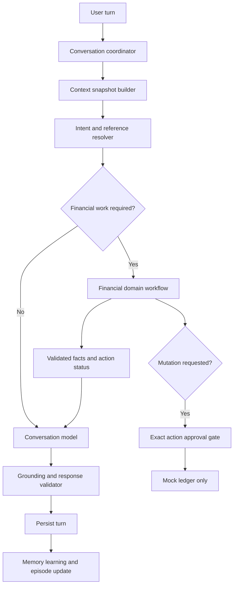

# Victoria: Conversational Core, Memory, and Personalization — Evidence-Backed Engineering Review

**Review date:** October 27, 2026  
**Repository:** [`NeverEverFelix/victoria`](https://github.com/NeverEverFelix/victoria)  
**Inspected ref:** `feature/conversational-memory-personalization`, commit `8b92be3f4d7a1310341786239e0ad1678a3ca86b`  
**Relevant PRs:** [#20: Expand conversational memory and personalization](https://github.com/NeverEverFelix/victoria/pull/20), stacked on [#19](https://github.com/NeverEverFelix/victoria/pull/19)  
**Method:** Read source code and repository PR metadata, including specific routing, response-validation, memory, and context-building implementations. No live end-to-end execution or local test rerun was performed. Some repository session-history notes explicitly say their most recent changes were *uncommitted and unpushed*; this report does **not** assume those local modifications are available on GitHub.

## Executive conclusion

Victoria has substantial infrastructure for a personalized companion: an agent orchestrator, SQLite-backed recent conversation context, Postgres/semantic durable memory, memory correction and forgetting, episodic summarization, a typed conversation context builder, pending financial workflow state, a separate OpenAI conversational responder, and guarded mocked-ledger tools. But it is still primarily a **financial workflow orchestrator with conditional conversational branches**, not a **conversation-first assistant with optional financial capabilities**.

The key next milestone should be **Conversational Core v1**: every user turn enters a coherent conversational pipeline; the model receives a single canonical, provenance-aware context snapshot; financial domain specialists supply advisory or authoritative information only when required; deterministic code exclusively controls financial side effects; replies adapt length to user intent; memory learning is scoped, evidence-based and reversible. The existing code should be incrementally refactored rather than discarded.

## 1. Intended product behavior

Victoria should act like an engaging, responsive, ChatGPT-style assistant **within its explicit financial-companion mission**. It should comfortably discuss interests, jobs, routines, goals and personal decisions; naturally relate relevant personal knowledge to budgeting and savings; maintain context through corrections and topic changes; and become genuinely more tailored over time. It should **not** continually redirect ordinary messages into savings proposals, equate projections with realized funds, imply real transfers, or fabricate personal facts.

### Product invariants

1. **Conversation is the default**. An intent router may identify additional work, but ordinary user messages always get a useful conversational answer unless an explicit safety/policy concern requires otherwise.
2. **Memory helps, never dictates.** Memories have evidence, source, confidence, scope, timestamp and correction/forget state. Contradictory or stale memories should not be stated as certainty.
3. **Financial state is authoritative data, not inferred prose.** A pending proposal, projection, saved ledger entry and a real transfer must have distinct types and semantics.
4. **No side effects from language generation.** Only explicit, version-specific, validated approvals can trigger the permitted mocked-ledger mutation. Real money movement remains disabled.
5. **The response answers the question first.** A workflow reminder or limitation should not displace a relevant answer.
6. **Depth is adaptive.** Short exchanges can receive short replies; complex requests can receive multi-paragraph, structured, calculated explanations with grounded facts.

## 2. Current system inventory and observed architecture

| Capability | Verified implementation evidence | Assessment |
|---|---|---|
| Request orchestration | `src/agent/victoria-agent.ts`, `VictoriaAgent.respond` and `respondTurn` | Centralized, complex, financial-first branching |
| Recent-turn memory | `getConversationContext`, `setConversationContext` in `VictoriaAgent.respond`, approx. lines 141–169 | Exists; limited bounded context used |
| Long-term memory | `MemoryOrchestrator`, `PostgresMemoryRepository`, `SqliteCachedMemoryProvider` | Substantial functionality, contextual use remains incomplete |
| Memory learning | `extractConversationalMemory`, optional model extractor, extraction path approx. lines 666–927 | Guarded but sometimes branch-gated |
| Episodic memory | `summarizeOverflowingConversation`, `summarizeConversation` approx. lines 173–200 | Present; extraction and recall limits matter |
| Context builder | `buildVictoriaConversationContext`, `selectMemoryFacts` | Typed workflow and financial context, not uniformly passed to response generation |
| Workflow state | `conversation-state-manager.ts` pending clarification and active proposal state | Good base; broader topic/dialogue state needed |
| General conversation | `OpenAiConversationResponder` and `respondConversationalTurn` | Optional route, subject to short-response constraints |
| Specialized responses | `classifyWithTeam`, specialist adapters and `team-response-policy.ts` | Necessary for finance; can dominate everyday conversation |
| Personalization | `OpenAiPersonalizedReply`, `selectPersonalizationMemories` | Exists but is an additional conditional rewrite path |
| Approval guard | `policy.ts`, pending action and mock ledger branches | Preserve exact-action approval boundaries |

### Current flow (simplified)

```text
request
  -> restore pending action(s)
  -> load prior conversation context
  -> save current user turn
  -> respondTurn()
      -> pending correction, allocation, savings branches
      -> rule-based and optional provider memory extraction
      -> ordinary-question shortcut sometimes invokes ConversationResponder
      -> otherwise classify with financial specialist team
      -> resolve financial references / proposals / validation
      -> decide financial workflow or general response
      -> optionally personalize some reflection replies
  -> save assistant turn
```

This is not inherently unsafe. Its downside is that **whether a user receives an open, natural reply depends on branch conditions**. An independent conversational layer does not have a stable first-class status.

## 3. Evidence-backed findings and failure examples

### F1 — Conversation route is conditional, not primary [HIGH; confirmed source]

**Evidence:** [`src/agent/victoria-agent.ts`](https://github.com/NeverEverFelix/victoria/blob/feature/conversational-memory-personalization/src/agent/victoria-agent.ts), approx. lines 929–933:

```ts
if (this.dependencies.conversationResponder && isOrdinaryQuestion(request.message) &&
    !hasFinancialActionSignal(request.message)) {
  return this.respondConversationalTurn(request, conversationContext,
    "I can help think that through. What would be most useful to focus on first?");
}
```

`isOrdinaryQuestion` around lines 2820–2824 requires `?` and excludes certain action phrases. `hasFinancialActionSignal` around lines 2844–2846 matches `\$`, “budget,” “bill,” “spending,” “money,” “savings,” and other terms. Those are coarse routing heuristics, not nuanced intent classification.

**Possible failure (architecture-derived scenario, NOT a verified live transcript):**

```text
User: I've been anxious about money ever since I got promoted.
Risk: No question mark; the ordinary-question shortcut does not trigger.
      The message enters a more financially oriented classification/workflow path.
Bad result class: Generic financial prompting rather than engaging the emotion or promotion context.
```

**Desired behavior:**

```text
Victoria: A promotion can improve your finances without making the decisions feel simpler.
What part has been weighing on you: expectations, spending changes, or something else?
```

**Change:** Introduce a first-class intent decision (`conversation`, `information`, `financial_analysis`, `financial_action`, `memory_management`) with multi-intent support. Default to conversation when action confidence is low. For financial discussion, answer conversationally while selectively invoking finance calculations. Avoid `?` as a prerequisite to conversational treatment.

**Acceptance test:** Unpunctuated reflections, statements with money-related nouns, topic changes and indirect questions get substantive, context-specific conversational answers without any ledger proposal.

### F2 — General responder lacks the complete typed context [HIGH; confirmed source]

**Evidence:** [`conversation-responder.ts`](https://github.com/NeverEverFelix/victoria/blob/feature/conversational-memory-personalization/src/agent/conversation-responder.ts) defines input as `message`, `recentTurns`, `memories`, `baselineReply`, optional `pendingAction` and optional `conversationSavingsEvents`. `VictoriaAgent.respondConversationalTurn` around lines 1332–1354 creates this input from raw context strings and a simplified memory projection.

Yet [`conversation-context-builder.ts`](https://github.com/NeverEverFelix/victoria/blob/feature/conversational-memory-personalization/src/agent/conversation-context-builder.ts) can produce a richer `VictoriaConversationContext` with `financialFacts`, `selectedMemoryFacts`, `conversationSavingsEvents` and `workflowState` (approx. lines 121–172). This richer representation is used in finance-related classification, but it is not uniformly passed to the general responder.

**Possible failure:** A user references “the other amount” while the canonical pending proposal knows the monthly recordable amount and separate annual projection. A responder only looking at trimmed dialogue strings may be unable to distinguish whether “other” refers to a projection, a plan, or a ledger entry.

**Desired behavior:**

```text
User: Let's use the yearly number for the plan.
Victoria: We can plan around $420 for the year if the gym benefit continues.
That doesn't mean $420 has already been saved. We can track the plan separately
from any actual monthly savings you choose to record.
```

**Change:** Build one `ConversationContextSnapshot` per turn, containing messages, active topic, references, validated financial facts, memory provenance, episode retrieval and pending workflow state. Pass only the relevant safe view of this same snapshot to all generation and domain components. Crucially, ensure the model never gets approval authority merely by seeing structured state.

### F3 — Response length/presentation is globally constricted [HIGH; confirmed source]

**Evidence:** `OpenAiConversationResponder` instructions direct at most three short sentences, aim under 450 characters, and avoid lists. `validateConversationReply` rejects response text greater than 1,500 characters. [`openai-personalized-reply.ts`](https://github.com/NeverEverFelix/victoria/blob/feature/conversational-memory-personalization/src/agent/memory/openai-personalized-reply.ts) separately aims for under 500 characters.

**Possible failure:**

```text
User: Can you compare three ways I can use the freed-up $35 per month and
explain the pros, cons and risks over a year?
Risk: An extremely short no-list response omits the requested tradeoffs,
      calculations or structure.
```

**Desired behavior:** A structured comparison of options, justified tradeoffs, explicitly conditional `$420` annual total, assumptions and an optional recommendation. Allow a longer reply when complexity warrants it.

**Change:** Determine response mode (`brief`, `normal`, `detailed`) from question complexity and explicit user preference; use token budgets rather than universal character caps. A fraud/unsupported-claim validator is separate from style constraints. Support paragraphs, enumerations and grounded calculations for complex questions.

### F4 — Validation can reject legitimate derived amounts [HIGH; confirmed source]

**Evidence:** `validateConversationReply` constructs `sourceAmounts` by scanning dollar amounts present in `input.message`, `recentTurns`, and any supplied savings events, then rejects a draft containing a dollar amount not in that set. This is a useful anti-invention boundary but does not recognize new *derived* results from a vetted calculation tool or grounded amount in durable memory unless already in those allowed strings.

**Failure example:**

```text
User: My employer covers my gym, which used to cost $35 per month.
Victoria (model draft): That's $420 per year if coverage continues.
Validator: Could reject $420 because it was not explicitly present in the
           user message, recent strings or allowed event amounts.
Result: A less helpful generic baseline might be returned instead.
```

**Important qualifier:** This is a deterministic input-dependent possibility; whether this particular exact exchange fails depends on whether `$420` is already included in `recentTurns` or events. The repository's specialized financial paths may also compute the projection safely outside the general responder.

**Change:** Add a typed `ValidatedFinancialFact` with `valueCents`, `factKind`, `origin`, `scope`, `asOf`, `calculation` and a human-readable qualifier. Allow model wording to use numerical results only when they match a validated fact or a deterministic computation. This removes the need to ban all useful new calculations.

### F5 — Fallbacks can discard the real question [HIGH; confirmed mechanism]

**Evidence:** `VictoriaAgent.generateConversationReply`, approx. lines 1356–1364:

```ts
try {
  const candidate = await this.dependencies.conversationResponder.respond(input);
  return validateConversationReply(candidate, input) ?? input.baselineReply;
} catch {
  return input.baselineReply;
}
```

**Risk:** An invalid response, timeout or provider error becomes the baseline. Some baselines are generic, such as “I can help think that through. What would be most useful to focus on first?” The safety intent is sensible, but it can make conversational quality collapse without diagnostic visibility at the user interaction level.

**Desired behavior:** If safe, offer a grounded minimal answer using known context; if knowledge is insufficient, ask one truly necessary question. Do not always lead with a vague “what part?” question.

**Change:** Record a structured `fallbackReason` without logging sensitive message contents. Use separate recovery policies for `read_only_conversation`, `financial_read_only`, and `financial_mutation`: a read-only response can receive one grounded revision or concise deterministic content, while action approval failures must fail closed. Add metrics on rejection categories and human-graded fallback quality.

### F6 — Pending financial workflow can crowd out regular dialogue [HIGH; confirmed source]

**Evidence:** `victoria-agent.ts`, approx. lines 1095–1109 and 1134–1152 contain pending-action paths returning confirm/decline messages. Other paths, around lines 248–250, 292–294 and 581–584, special-case conversational topic switches. The fact that these exceptions exist is progress, but demonstrates topic handling is interwoven with approval/workflow logic.

**Possible failure:**

```text
Victoria: Would you like to record $35 in the mocked ledger?
User: I actually want to talk about what the promotion means for my budget.
Risk: A pending-proposal guard could prioritize approval resolution instead
      of the requested financial discussion, depending on classification.
```

**Desired behavior:**

```text
Victoria: Sure. With the gym covered, you have more monthly flexibility,
although what you do with it depends on your broader expenses. We can talk
through priorities first. The $35 ledger proposal can stay unrecorded.
```

**Change:** Keep `PendingAction` immutable/persistent and separate from `DialogueState`. Topic changes should not implicitly approve, decline, recreate or mutate a proposal. Make explicit approval and amendment commands address a specific pending version, while unrelated conversation passes through normally.

### F7 — Some memory handling remains classification-dependent [MEDIUM; confirmed source]

**Evidence:** `victoria-agent.ts` approximately lines 898–928 runs the optional model extractor only for a fixed set of classification types (`general_finance`, `pattern_reflection`, `avoided_spend`, `regretful_spend`, and some `unclear` cases), and suppresses it in several pending-action or extracted-memory scenarios. Rule-based extraction paths also exist (approx. lines 666 onward).

**Risk:** Interesting personal information in a multi-intent or pending-action turn may not be saved, even if it was stable and explicitly volunteered. Conversely, assigning all facts to permanent memory would be undesirable.

**Desired behavior:** Separate memory-learning eligibility from financial intent category; extract candidate facts from the accepted turn, assess whether they are stable and permission-appropriate, merge/supersede with evidence, and independently handle user instructions to correct or forget.

**Change:** Use asynchronous-in-process **post-turn** memory extraction where reliability permits, with a durable job/transaction boundary if persistence guarantees matter. Never tell the user something was remembered before storage confirms success. For high-importance correction/forget instructions, apply the change before subsequent retrieval. Bound PII propagation and retention according to transparent settings.

### F8 — Memory retrieval's provenance gate is useful but narrow [MEDIUM; confirmed source]

**Evidence:** `conversation-context-builder.ts`, `selectMemoryFacts` around lines 197–216 permits only `user_statement` and `user_correction`, requires confidence >= 0.85, validates evidence and caps facts at six. Elsewhere `selectPersonalizationMemories` in `victoria-agent.ts` around lines 2942–2959 filters by memory types, semantic match, communication preferences and text overlap, returning at most six.

**Risk:** The assistant may know a related past *episode* or derived financial profile that doesn't qualify for one retrieval path. Hard-coded limits and separate selectors can cause inconsistent recalled context. On the other hand, broadening these filters without provenance checks could introduce hallucinations.

**Change:** Implement a common retrieval planner: query rewrite, topically relevant semantic/episodic search, scoring for recency and applicability, exclusion of forgotten/stale superseded facts, conflict detection and per-type budgets. Strong evidence should override speculative inferences. Reserve limited permanent-profile facts (e.g., user's stated savings goal) alongside dynamic retrieval; include a small episodic summary only when relevant.

### F9 — Short-term memory, episodic memory and financial authority require clearer boundaries [MEDIUM; confirmed source]

**Evidence:** `VictoriaAgent.respond()` loads bounded transcript strings, calls `summarizeOverflowingConversation`, and persists the latest messages. `summarizeConversation` around lines 183–200 selects recent user utterances, deduplicates by digest and saves episode candidates. `MemoryOrchestrator` separately owns current-memory filtering, correction and forgetting.

**Risk:** Summarizing only a narrow tail or only user utterances could miss the decision outcome or assistant's question that gives the user's “yes” or “monthly” its meaning; however, the summarizer may have other safeguards beyond the excerpt. Episodes should never be used as proof that a payment or transfer happened.

**Change:** Generate episodes from structured turn-pairs plus authoritative decisions, with a summary that separates `user said`, `assistant suggested`, `user confirmed`, `workflow recorded`, and `unknown`. Provenance-link episodes to immutable events and apply retention/forget policies transitively.

**Implementation boundary discovered during continuation (October 27, 2026):** The current `VictoriaAgent.respond()` persistence path stores a bounded `readonly string[]` conversation transcript and does not receive the durable `TurnRecord.id` from `submit-turn-handler.ts` / `TurnRepository`. Episode keys are currently content digests, not source-turn identifiers. Do not label those digests as turn IDs. Exact episode-to-turn provenance requires an explicit, user-scoped turn-reference contract through the chat runtime into the agent (and an append-only migration for persisted episode evidence links); until then, topic-based lifecycle suppression remains the conservative fallback. Authoritative ledger outcome IDs must remain separate from user-message evidence references.

### F10 — Large orchestrator class makes behavior brittle [MEDIUM; confirmed source]

**Evidence:** The inspected `victoria-agent.ts` is 3,268 lines. It coordinates memory learning, financial classification, pending action restore/revisions, approval, specialized messages and general conversation. The complexity itself is not proof of a defect, but makes comprehensive conversational paths difficult to reason about and regression-test.

**Change:** Extract bounded modules for the conversation orchestrator, intent router, dialogue state, response composition and financial workflows. Keep thin compatibility adapters around the current system during migration.

### F11 — Merge/configuration readiness is distinct from conversational quality [MEDIUM; PR evidence]

**Evidence:** PR #20 is open and stacked on PR #19, also open. Repository notes dated October 26 report `npm run check` passed with 675 tests passed, 19 skipped, 9 todo, but also state that some current architecture changes were **uncommitted and unpushed**. PR review threads flag inconsistencies in default-on episodic summarization, personalized-reply feature flags and documentation safety contracts.

**Change:** Before merging, reconcile env defaults and privacy/retention policy, ensure approval-gate regressions pass, verify the exact pushed head CI, and resolve high-severity AI review comments individually. Do not interpret passing unit counts as proof of natural multi-turn performance.

## 4. Original gym conversation: evidence-based behavioral trace

**Observed user-supplied example (from prior conversation, NOT a replay executed for this report):**

```text
User: I usually go to this gym to play basketball and it costs me $35 a
month. However, I just got a promotion at my work and it comes with a gym
package so now the company pays. Would it be a good idea to allocate this
money somewhere else?

Victoria: [recognized $35/month and $420/year, and asked monthly or annual]

User: annual

Victoria: Got it: $420.00 is the yearly target you'd like to work toward,
based on $35.00 a month if your gym stays covered. I can start by recording
this month's $35.00 in your Victoria savings ledger. Say yes to confirm.
No real money moves.

User: bruh record the yearly amount

Victoria: I can help think that through. What part would be most useful to
start with? The savings suggestion remains pending and has not been recorded.
```

**What went wrong conceptually:** The user selected an **annual planning horizon**, while the agent continued to present a **monthly recordable mock ledger entry**. When the user asked for the yearly number, the system responded generically without explicitly acknowledging that annual planning and realized monthly entry are separate types. The two amounts are mathematically related but not interchangeable for recording. A separate, previously identified issue was insufficient grounded reference resolution for “yearly amount.” The current branch has made progress with typed planning choice and reference resolution, but its own October 26 notes say arbitrary older-event references and broader typed workflow states remain unfinished.

**Correct semantic objects:**

| Object | Value | Meaning | Can increment realized/mock recorded savings? |
|---|---:|---|---|
| Previously paid recurring cost | $35/month | Historical monthly expense | No |
| Employer benefit | Covers cost | Conditional change to spending | No |
| Annual projection | $420/year | $35 x 12 if benefit lasts | No |
| Planning target | $420 over 12 months | Future allocation preference | No |
| Explicitly approved current-month mock entry | $35 | Recorded mocked savings event | Yes, in mock ledger only |
| Real transfer | N/A | Actual movement of bank funds | Prohibited in MVP |

**Better interaction with existing capabilities:**

```text
User: I want to plan annually.
Victoria: We can use $420 as your yearly plan, assuming the gym stays
covered for all 12 months. That's different from money you've already set
aside. Want to explore where that $420 could go?

User: bruh record the yearly amount
Victoria: You mean the $420 annual projection, not this month's $35.
The current mocked ledger only records the monthly amount after approval;
it can't record a full year's projected savings as if they happened. I
can still use $420 as your planning target. Nothing has been recorded.
```

**Future behavior if (and only if) a distinct projected-goal tool is implemented:** Victoria can propose `createAnnualSavingsTarget({ amountCents: 42000, periodMonths: 12, sourceMonthlyCents: 3500 })`, require confirmation for the exact action, and store it in a **planning-goal** domain that does not affect realized savings totals. Do not claim this tool exists today.

## 5. Proposed Conversational Core v1 architecture



**Design decision:** One user-facing responder is always responsible for the final conversational expression, but it must accept **immutable validated domain results**. For a confirmed ledger entry, do not let a failed generative rewrite falsely modify the acknowledgment. Domain mutation completion text may be fixed or tightly templated.

### Suggested module organization

```text
src/agent/
  conversation/
    conversation-orchestrator.ts
    context-builder.ts
    intent-router.ts
    dialogue-state.ts
    reference-resolution.ts
    response-composer.ts
    response-policy.ts
  memory/
    memory-orchestrator.ts       # retain existing; evolve contract
    memory-retriever.ts
    memory-extractor.ts
    episodic-memory.ts
    memory-privacy-policy.ts
  financial/
    workflow-coordinator.ts
    financial-facts.ts
    proposal-state.ts
    approval-gate.ts
  victoria-agent.ts             # thin adapter to preserve public interface
```

Avoid introducing an independent LLM to every layer. Start with **one main responder**, a cheap routing path and existing financial specialists invoked only when necessary. That reduces cost, latency and chances of specialist responses contradicting each other.

## 6. Proposed contracts and TypeScript sketches

These are illustrative **target-state designs**, not claims that the repository currently implements the exact types.

### 6.1 Canonical context snapshot

```ts
type Provenance =
  | { type: "user_statement"; turnId: string }
  | { type: "user_correction"; turnId: string; supersedesId: string }
  | { type: "authoritative_ledger"; eventId: string }
  | { type: "derived_calculation"; formula: string; inputIds: string[] }
  | { type: "model_inference"; evidenceIds: string[] };

interface SelectedMemory {
  id: string;
  kind: "fact" | "preference" | "goal" | "episode" | "inference";
  value: string;
  scope: "global" | "topic" | "event";
  topicId?: string;
  confidence: number;
  observedAt: string;
  provenance: Provenance;
}

interface FinancialFact {
  id: string;
  kind: "past_expense" | "projection" | "plan" |
        "recorded_mock_savings" | "verified_account_data";
  amountCents: number;
  period?: "one_time" | "monthly" | "annual";
  condition?: string;
  provenance: Provenance;
}

interface DialogueState {
  activeTopicId?: string;
  pendingQuestion?: { id: string; question: string; expectedAnswerType: string };
  resolvedReferences: Record<string, string>;
}

interface ConversationContextSnapshot {
  userId: string;
  conversationId: string;
  recentTurns: ReadonlyArray<{ role: "user" | "assistant"; content: string }>;
  dialogue: DialogueState;
  memories: readonly SelectedMemory[];
  financialFacts: readonly FinancialFact[];
  pendingAction?: {
    actionId: string;
    version: number;
    status: "pending" | "approved" | "declined";
    kind: string;
  };
}
```

### 6.2 Routing without action authority

```ts
type TurnIntent = {
  conversation: boolean;
  informationRequest: boolean;
  financialAnalysis: boolean;
  financialActionRequest: boolean;
  memoryCorrectionRequest: boolean;
  explicitApprovalReference?: {
    actionId: string;
    version: number;
  };
};

async function handleTurn(turn: UserTurn) {
  return conversationCoordinator.serialize(turn.conversationId, async () => {
    const context = await contextBuilder.build(turn);
    const intent = await intentRouter.resolve(turn.message, context);

    // Finance specialists are advisory unless they return an approved,
    // independently validated request for a deterministic workflow step.
    const financial = intent.financialAnalysis || intent.financialActionRequest
      ? await financialWorkflow.evaluateReadOnly({ turn, context, intent })
      : undefined;

    // A mutation must be handled by a separate authenticated,
    // version-specific approval path before constructing any completed-action text.
    const mutation = intent.financialActionRequest
      ? await approvalCoordinator.processIfExplicitlyAuthorized({ turn, context, intent })
      : undefined;

    const draft = await responder.compose({ turn, context, financial, mutation });
    const reply = await responsePolicy.validateOrRecover({ draft, turn, context, financial, mutation });
    await transcriptStore.appendTurnAndReply(turn, reply);
    await memoryLearningQueue.enqueue({ turnId: turn.id });
    return reply;
  });
}
```

**Implementation cautions:** `serialize()` in a horizontally scaled deployment must not be an in-process mutex alone. Use database-backed sequencing/idempotency/optimistic concurrency as appropriate. `enqueue` must be durable or replayable if memory persistence guarantees are required; do not promise memories are saved if a job has only been enqueued. User authentication, ownership checks and permission scopes are required before each data access. The code intentionally omits these adapters for readability.

### 6.3 Validated mathematical derivation

```ts
function annualProjection(monthly: FinancialFact): FinancialFact {
  if (monthly.period !== "monthly" || monthly.amountCents < 0 ||
      !Number.isSafeInteger(monthly.amountCents) ||
      !Number.isSafeInteger(monthly.amountCents * 12)) {
    throw new Error("Invalid monthly amount");
  }
  return {
    id: `annual:${monthly.id}`,
    kind: "projection",
    amountCents: monthly.amountCents * 12,
    period: "annual",
    condition: "Monthly employer coverage continues for all 12 months",
    provenance: {
      type: "derived_calculation",
      formula: "monthlyAmountCents * 12",
      inputIds: [monthly.id]
    }
  };
}
```

A reply validator should accept `$420` when it matches this validated result, without requiring the string `$420` to appear in the prior transcript. It should still reject an unsupported `$4,200` statement.

### 6.4 Action safety state machine

```text
DRAFT -> PENDING_APPROVAL -> APPROVED -> RECORDED
                     |            
                     +-> DECLINED
                     +-> EXPIRED
                     +-> SUPERSEDED (revision creates a new version)
```

Store `actionId`, `version`, `userId`, `conversationId`, `kind`, `recordableAmountCents`, `basis`, `sourceEventId`, `idempotencyKey`, `expiresAt` and `approvalEvidence`. Approval must reference the **current** version and exact recordable action; an annual planning preference is not an approval to record twelve monthly entries. Retrying a request must not double-record. Never use a general language model's narrative as evidence that mutation succeeded.

## 7. Memory and personalization design in depth

### Working memory

Use a rolling window of structured turn pairs and the current dialogue state. Keep recent unanswered questions, currently resolved pronouns/references and short-lived topic context. An assistant message such as “Would you like monthly or annual?” must stay attached to the subsequent user reply “monthly”; raw text without role and relationship makes that harder.

### Semantic memory

Store durable facts and explicitly stated personal goals or communication preferences with source references. Example: `interest:basketball` may be a stable user statement; `allocation_style:monthly` should initially be scoped to the gym coverage decision, **not** upgraded to a global rule. If repeated independently over time, infer a broader tendency only with supporting observations and lower confidence than a direct preference.

### Episodic memory

Store coherent summaries of events: “User reported employer covering a previously self-funded $35/month basketball gym; discussed $420 annual projection; chose monthly planning horizon; no actual transfer occurred.” Preserve the distinction between what was said, recommended, approved, and actually recorded. Episodes should have timestamps and links to original turn IDs and domain records. Do not embed discarded or forgotten memories back into future episodes.

### Financial memory

Use authorized transaction data and ledger/event records as authoritative. Financial profiles are not conversation transcripts. Present figures with as-of dates and reliability indicators. When a user corrects a specific transaction, update/supersede the relevant claim rather than incorrectly overwriting an aggregate pattern.

### Retrieval planner

1. Extract topical entities and unresolved references from the active user message and recent turn state.
2. Always include a small set of explicit stable preferences/goals when relevant.
3. Retrieve top semantic facts and episodes with strict user/tenant scoping.
4. Rank by topic relevance, evidence quality, temporal applicability and freshness.
5. Filter forgotten, superseded, expired and prohibited records.
6. Detect contradictory memory claims and prefer fresh user corrections.
7. Pack a bounded context with source metadata, not merely flattened `key/value` strings.
8. Track which memories materially influenced the response for debugging and user control.

### How personalization should sound

**User:** “I'm thinking about cutting back on takeout.”

**Bad (generic):** “You should create an emergency fund and reduce unnecessary spending.”

**Bad (over-personalized):** “As someone who loves basketball and got a promotion, you should stop ordering food.”

**Better:** “Is takeout mostly a convenience thing on busy days, or is it something you genuinely enjoy? That changes whether a spending limit or a few planned meals makes more sense.”

If a relevant previously stated goal exists, Victoria can reference it naturally: “If you're still aiming to save 30% of your income, we can see what a realistic takeout budget would contribute.” Only use that goal if the same user genuinely provided it and has not corrected or forgotten it.

## 8. Proposed response policy

A single universal “under 450 characters” policy is incompatible with ChatGPT-like assistance. Use three adaptive bands:

| Response mode | Typical trigger | Shape |
|---|---|---|
| Brief | Direct single question or acknowledgment | 1–3 focused sentences |
| Standard | Advice or moderate ambiguity | 1–3 paragraphs, at most one necessary follow-up |
| Detailed | “Explain deeply,” planning, comparisons, calculations | Structured analysis, calculations, caveats, clear next steps |

Avoid long disclaimers on every turn. Financial actions, changed assumptions and sensitive estimates require accurate disclosure, but statements such as “No real money moves” should not be mechanically appended to every purely conversational response. Use it when the user might reasonably interpret a financial action as real or completed.

Separate validation concerns into:

- **Truth/grounding:** Is each asserted financial value or recalled memory backed by allowed evidence?
- **Action accuracy:** Does the response accurately reflect what the ledger/action service did?
- **Safety and privacy:** Does it avoid unauthorized transfers, sensitive leaks or problematic directives?
- **Conversation quality:** Does it answer the actual question and maintain continuity?
- **Style:** Does length and structure fit the user's request?

A failure on style should usually trigger revision, **not** a generic no-context response. A failure in action authorization must fail closed.

## 9. Regression suite: evidence-based scenario matrix

The tests below are **proposed**, not claimed to exist or pass.

| Scenario | User sequence | Expected result | Regression caught |
|---|---|---|---|
| Ordinary reflection | “I've been stressed about money lately.” | Addresses emotional/practical issue without ledger prompt | F1 |
| No question mark | “I want to talk about changing jobs” | Genuine topical response | F1 |
| Finance vocabulary | “My budget is overwhelming me” | Answers conversationally, no forced transaction | F1 |
| Complex request | “Give me three options with pros and cons” | Detailed structured answer | F3 |
| Derived figure | `$35/month` then “what is that yearly?” | `$420` conditional projection accepted | F4 |
| Implicit reference | “I prefer the yearly one” | Maps to correct annual **planning** horizon | F2 |
| Pending action topic switch | Proposal pending; “let's talk about work” | Answers work query; proposal unchanged | F6 |
| Wrong-amount revision | Pending `$35`; “record yearly amount” | Explains projection-vs-recording distinction; does not approve `$35` | F2/F6 |
| Ephemeral preference | “Monthly for this gym plan” | Scoped to gym plan, not global preference | F7/F8 |
| Contradictory preference | “Actually I now prefer annual planning for this expense” | Supersedes scoped prior choice | F7/F8 |
| Cross-session episode | “Remember that gym benefit we discussed?” | Recalls accurate relevant episode with qualifiers | F8/F9 |
| Forget memory | “Forget that I play basketball” | No subsequent retrieval of that fact | F8/F9 |
| Provider timeout | Conversation request while model times out | Useful grounded fallback; no fabricated results | F5 |
| Multi-worker retry | Approval request repeated after timeout | Exactly one mocked entry or no entry, never double-write | Action safety |
| Hallucinated balance | Assistant invents account balance | Rejected; requests verified data | Grounding |
| Financial correction | User corrects recorded amount | Versioned correction flow, fresh approval | Action safety |
| Memory extraction failure | Extractor unavailable | Conversation still works and doesn't claim memory stored | F7 |

### Evaluation methodology

- Write **50–100 multi-turn dialogues** with context and realistic paraphrases, not only one-shot classifier examples.
- Add turn-by-turn golden assertions for `resolvedIntent`, selected memories, active proposal ID/version, computation provenance, response coverage and mutation count.
- Include no-question-mark statements, colloquial corrections, topic switching, indirect references and contradictory evidence.
- Run deterministic unit tests and staged provider tests separately; provider tests need human rubric or model-graded evaluations audited with samples, because exact wording is not stable.
- Record p50/p95 total latency; model calls per turn; tokens per component; fallback and validator rejection rates; memory retrieval precision; context-reference resolution success; user-perceived answer relevance.
- Ensure test fixtures do not contain real account secrets or production customer histories.

## 10. Phased implementation plan

### Phase 0 — Pin and verify the baseline

- Record branch/commit and compare it with the exact local development tree.
- Resolve critical PR #20 AI review comments and safety/privacy policy inconsistencies.
- Re-run CI and a small end-to-end CLI suite against the actual intended commit.
- Add diagnostics for why the general responder path was not selected and why candidate replies were rejected.

**Exit criterion:** Reproducible baseline and no open high-severity action/retention issues.

### Phase 1 — Canonical context and conversation-first entry point

- Extract shared `ConversationContextSnapshot` construction.
- Replace question-mark/keyword gating as the primary decision path.
- Distinguish informational/analytical intents from mutation intents.
- Preserve deterministic approval and validation guards.

**Exit criterion:** Ordinary and complex finance-adjacent messages get on-topic replies in regression scenarios; no unauthorized ledger action.

### Phase 2 — Adaptive response composer

- Consolidate the ordinary conversation responder and personalized rewrite into a coherent user-facing reply policy.
- Pass typed validated facts and selected memories, not disconnected strings.
- Implement adaptive verbosity and a calculation-proof-aware validator.
- Improve failure reasons and contextual fallbacks.

**Exit criterion:** Financially grounded, detailed answers survive validation and meet relevance rubrics.

### Phase 3 — Conversation/dialogue state separation

- Track topic switches and unresolved questions separately from proposals.
- Expand reference resolution to previously grounded, relevant events within allowed scope.
- Add immutable proposal versions, stale-approval rejection and idempotency across workers.

**Exit criterion:** Topic switches don't lose state; implicit references resolve correctly; no stale or double approvals.

### Phase 4 — Memory quality

- Introduce common retrieval planning and evidence-linked episodes.
- Make stable-memory extraction intent-independent but sensitivity-aware.
- Enforce correction/forget/expiration through all retrieval surfaces and summaries.
- Provide reviewable user memory controls and telemetry.

**Exit criterion:** Cross-session memory is relevant, correctable, privacy-respecting, and does not intrude unnecessarily.

### Phase 5 — Product-level conversational evaluation

- Build a stable provider-eval corpus and human quality rubrics.
- Test lengthy conversations and adversarial references with production-like worker concurrency.
- Gate rollout on conversational relevance and action safety, not unit-test volume alone.

**Exit criterion:** Demonstrated improvements in response relevance, continuity, memory utility and safety with manageable latency/cost.

## 11. Key architectural anti-patterns to avoid

1. **Adding more regexes whenever Victoria misunderstands a message.** Regex remains useful for narrow safety-critical literals, not general semantic comprehension.
2. **Treating a long prompt as a substitute for dialogue state.** Natural-language transcripts are insufficient authority for pending actions.
3. **Putting memory in every answer.** Personalization is relevance, not constant mention of stored trivia.
4. **Forcing every conversation into a proposed ledger entry.** Discussing savings is not approving savings.
5. **Giving the model approval or transfer authority.** Prose generation does not execute authenticated financial side effects.
6. **Storing speculative inferences as durable facts.** Scope, provenance and confidence must survive storage.
7. **Accepting numerical model calculations without validation.** Use deterministic calculators for financial values.
8. **Turning all response failures into “What would you like to focus on?”** Safe fallbacks should still use known context.
9. **Combining all domain and dialogue logic inside `VictoriaAgent`.** Modularize by responsibility while preserving tested contracts.
10. **Assuming passing unit tests means ChatGPT-like conversation.** Evaluate multi-turn behavior, user intent fulfillment and memory use explicitly.

## 12. Final recommendation

**Prioritize Conversational Core v1 before adding new money-movement or product features.** Keep the strong mocked-ledger safety boundaries and existing memory infrastructure. Implement a conversation-first orchestration path, a canonical typed context snapshot, a unified response composer, separate workflow state, provenance-aware retrieval, and multi-turn conversation evaluations. The defining user experience should be that **Victoria talks naturally and intelligently about a person's life, remembers only what is appropriate, and recognizes actionable financial moments without interrupting the conversation or confusing plans with actual money**.

---

## Source index and provenance

**Source reviewed at the GitHub branch above:**

- [`src/agent/victoria-agent.ts`](https://github.com/NeverEverFelix/victoria/blob/feature/conversational-memory-personalization/src/agent/victoria-agent.ts) — turn orchestration, memory extraction, pending action paths, response fallback and routing helper functions.
- [`src/agent/conversation-responder.ts`](https://github.com/NeverEverFelix/victoria/blob/feature/conversational-memory-personalization/src/agent/conversation-responder.ts) — general responder input, OpenAI instructions, amount validation, reply length restriction.
- [`src/agent/conversation-context-builder.ts`](https://github.com/NeverEverFelix/victoria/blob/feature/conversational-memory-personalization/src/agent/conversation-context-builder.ts) — typed context including selected memory facts, financial facts and workflow state.
- [`src/agent/conversation-state-manager.ts`](https://github.com/NeverEverFelix/victoria/blob/feature/conversational-memory-personalization/src/agent/conversation-state-manager.ts) — typed pending financial workflow state and planning transitions.
- [`src/agent/memory/memory-orchestrator.ts`](https://github.com/NeverEverFelix/victoria/blob/feature/conversational-memory-personalization/src/agent/memory/memory-orchestrator.ts) — stored memory correction, supersession, filtering, retrieval.
- [`src/agent/memory/openai-personalized-reply.ts`](https://github.com/NeverEverFelix/victoria/blob/feature/conversational-memory-personalization/src/agent/memory/openai-personalized-reply.ts) — personalized-reply prompt and structured response.
- [`src/agent/prompts/system-prompt.ts`](https://github.com/NeverEverFelix/victoria/blob/feature/conversational-memory-personalization/src/agent/prompts/system-prompt.ts) — intended companion tone and financial safety principles.
- [`src/app/create-victoria-agent.ts`](https://github.com/NeverEverFelix/victoria/blob/feature/conversational-memory-personalization/src/app/create-victoria-agent.ts) — optional dependency wiring and agent composition.
- [`src/app/create-persistent-victoria-agent.ts`](https://github.com/NeverEverFelix/victoria/blob/feature/conversational-memory-personalization/src/app/create-persistent-victoria-agent.ts) — Postgres/SQLite memory composition.
- [`docs/session-history/2026-10-26-1355-conversation-context-state-verification.md`](https://github.com/NeverEverFelix/victoria/blob/feature/conversational-memory-personalization/docs/session-history/2026-10-26-1355-conversation-context-state-verification.md) — repository-reported tests and limitations, including uncommitted work.
- [`docs/VICTORIA_CONVERSATION_CONTEXT_ARCHITECTURE_REVIEW.md`](https://github.com/NeverEverFelix/victoria/blob/feature/conversational-memory-personalization/docs/VICTORIA_CONVERSATION_CONTEXT_ARCHITECTURE_REVIEW.md) — earlier issue diagnosis and original gym trace (reviewed as historical documentation, not a fresh runtime trace).
- [PR #20 description and AI-review discussion](https://github.com/NeverEverFelix/victoria/pull/20) — merge state, scope and review concerns.

**Evidence labels:** “confirmed source” means the inspected branch contains that implementation. “Possible failure” means the source permits or motivates the described risk but the example was not executed. “Observed user-supplied example” comes from the earlier reported gym exchange, and was not newly reproduced. Proposed code and architectural recommendations are designs, not deployed functionality.
